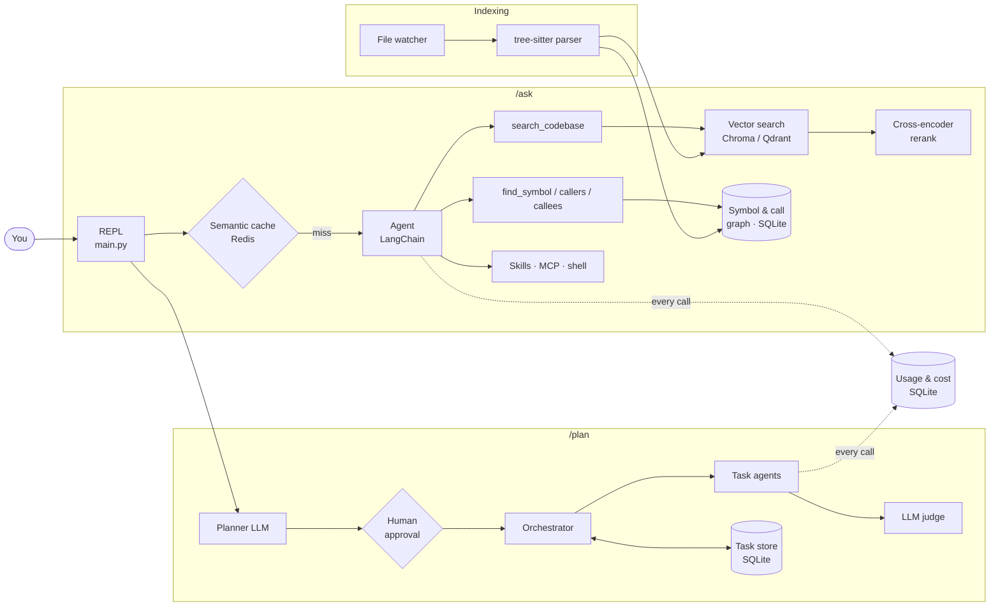

# RepoPilot

**An agentic AI code assistant that answers questions about any codebase and builds new projects from a goal.**

Run it inside a repository and ask questions in plain English. RepoPilot searches the code before it answers, cites the files it used, and can trace exactly who calls what. Give it a goal with `/plan` and a team of agents breaks it into steps, asks for your approval, then builds it, checking each step with an LLM judge.

```
> /ask what happens when a plan task fails?

When a task raises, TaskOrchestrator._execute calls fail_task, which increments
retry_count and either puts the task back to pending or marks it failed once
max_retries is reached. Any task depending on it is then marked blocked by
block_unreachable_tasks, so the run ends cleanly instead of waiting forever.

Sources:
  • tasks/orchestrator.py:97-115
  • tasks/task_store.py:226-276
```

*(Illustrative output — your answer will vary by model.)*

---

## Features

| | |
|---|---|
| **Code Q&A with RAG** | Code is split into functions and classes with tree-sitter (Python, JS/TS, Java, Go, Rust, C/C++, C# and more), embedded, and searched before every answer. Answers render as Markdown and list their sources. |
| **Runs for free** | Default setup uses Google Gemini's free tier for the LLM and local embeddings + reranking (fastembed/ONNX) — $0, and indexing needs no API key at all. OpenAI and Anthropic are one config line away. |
| **Two-stage retrieval** | Vector search fetches 20 candidates; a local cross-encoder (`jina-reranker-v1-tiny`, chosen by benchmarking three models on the eval set) reranks them and keeps the best 5. |
| **Call-graph search** | A symbol index records every function, method, class and call site, so the agent can answer *"what calls `fail_task`?"* exactly instead of by similarity. |
| **Multi-agent planning** | `/plan <goal>` → LLM planner builds a dependency graph of tasks → you approve or request changes → each task runs with its own least-privilege toolset → an LLM judge verifies it against acceptance criteria → failures retry, and dependents are blocked. |
| **Crash-safe execution** | Task state lives in SQLite (WAL). Tasks interrupted by a crash are recovered on the next run. |
| **Live index** | A file watcher re-indexes changed files within seconds; unchanged files are never re-embedded. |
| **Semantic cache** | Redis vector cache returns answers to repeated questions instantly — only for the first question in a session, so follow-ups never get a wrong cached answer. |
| **Conversation memory** | Sessions persist across restarts (LangGraph + SQLite); long conversations are summarised automatically. |
| **Evaluation suite** | `/eval` scores retrieval (hit rate, MRR), answer faithfulness and correctness (LLM-as-judge), latency and cost — and compares each run with the last. |
| **Cost tracking** | `/stats` shows tokens, cost and latency per feature, plus cache savings. |
| **Extensible** | Skills (`SKILL.md` files loaded on demand) and MCP servers (GitHub, filesystem) plug straight into the agent. |

## Architecture



## Commands

| Command | What it does |
|---|---|
| `/ask <question>` | Answer a question about the codebase, with sources |
| `/plan <goal>` | Plan and build a project with approval and verification |
| `/task_status` | Show progress of the latest plan |
| `/eval [file]` | Score answer quality on a question set |
| `/stats` | Token usage, cost and cache hit rate |
| `/show_index` · `/reindex` | Inspect or rebuild the search index |
| `/new_session` · `/switch <id>` · `/session` | Manage conversations |
| `/help` · `/exit` | |

## Getting started

**Requirements:** Python **3.12** (not 3.13 — `tree-sitter-languages` has no 3.13 build), [Poetry](https://python-poetry.org/) 2.x, and a free Gemini API key from [Google AI Studio](https://aistudio.google.com/apikey) (or an OpenAI / Anthropic key). Optional: Redis (for the cache), Qdrant (alternative vector store), Node.js (for MCP tools).

```bash
git clone <this repo> && cd repopilot
poetry env use 3.12                # create the environment with Python 3.12
poetry install                     # installs dependencies, pytest, and the `repopilot` command

copy .env.example .env             # macOS/Linux: cp — then add your GOOGLE_API_KEY
```

Then run RepoPilot **from inside the repository you want to analyse**. `--project` tells Poetry where RepoPilot is installed without changing the folder being analysed:

```bash
cd /path/to/any/repo
poetry --project /path/to/repopilot run repopilot
```

Or activate the environment once (`Invoke-Expression (poetry env activate)` in PowerShell, `eval $(poetry env activate)` in bash) and just run `repopilot` from any folder.

<details>
<summary>Without Poetry (plain pip)</summary>

```bash
cd repopilot
py -3.12 -m venv .venv && .venv\Scripts\Activate.ps1
pip install -r requirements.txt
pip install -e . --no-deps         # registers the `repopilot` package and command
```
</details>

On first start it indexes the repo (this is the only slow run — later starts only re-index changed files). Everything RepoPilot stores goes in a `.repopilot/` folder in that repo.

**Optional — semantic cache (Redis 8+ or Redis Stack, for vector search).** Without Redis, RepoPilot runs fine with the cache off.
- **Windows:** install Redis in WSL (`wsl --install -d Ubuntu-24.04`, then Redis 8 from [packages.redis.io](https://redis.io/docs/latest/operate/oss_and_stack/install/install-redis/install-redis-on-linux/)) and set `semantic_cache.wsl_distro` — RepoPilot starts it automatically.
- **Docker:** `docker run -d -p 6379:6379 redis/redis-stack-server`, and leave `wsl_distro` empty.

## Configuration

All settings live in [`src/repopilot/config.yaml`](src/repopilot/config.yaml); API keys go in `.env` in the project root (template: [`.env.example`](.env.example)).

| Section | Controls |
|---|---|
| `llm` | Provider (`gemini` / `openai` / `anthropic`), model, a cheaper `judge_model`, retries for rate limits. List the Gemini models your key can use with `python -m repopilot.llm.list_models` |
| `embeddings` | `fastembed` (local, free), `openai` or `huggingface`, and the model. Each model gets its own index, so switching is safe |
| `vector_store`, `rag`, `qdrant` | Chroma or Qdrant; dense, sparse (BM25) or hybrid retrieval |
| `rerank` | Turn reranking on/off, choose the cross-encoder and candidate count |
| `symbols` | Turn call-graph tools on/off |
| `semantic_cache` | Redis URL, similarity threshold, TTL |
| `memory` | When to summarise long conversations |
| `usage.prices` | USD per 1M tokens for each model, used by `/stats` and `/eval` |

## Evaluation

[`evals/questions.yaml`](evals/questions.yaml) contains 24 questions about RepoPilot's own code, each with the files that hold the answer and the facts a correct answer should mention. Run RepoPilot in this folder and type `/eval`:

| Metric | How it's measured |
|---|---|
| Retrieval hit rate / MRR | Is an expected file in the top 5 search results, and how high? (deterministic) |
| Context recall | Share of expected files the agent's tools actually returned (deterministic) |
| Fact recall | Share of expected facts mentioned in the answer (deterministic) |
| Faithfulness | Are the answer's claims supported by the retrieved code? (LLM judge) |
| Correctness | Does it fully answer the question? (LLM judge) |
| Latency, cost | From the usage tracker |

Each run is saved with a snapshot of the configuration, and the report shows the change from the previous run — so the effect of each component can be measured by switching it off and on.

### Retrieval benchmark (measured)

Search quality on the 24 questions, ranking RepoPilot's own code (file-level, no LLM involved):

| Embedding model | Search only: hit@5 / MRR | + reranker: hit@5 / MRR | Index time |
|---|---|---|---|
| `bge-small-en-v1.5` (default) | 83% / 0.65 | 83% / 0.68 | 38 s |
| `bge-base-en-v1.5` | 79% / 0.64 | 83% / 0.71 | 118 s |

Reranking never lowered hit@5 and moved the right file higher. `bge-small` is the default: equal accuracy on its own and 3× faster to index. With 24 questions, a difference of one question is about 4 points, so small gaps are within noise.

### Full `/eval` results

<!-- Fill in from your own /eval runs: run once per row, changing only the setting named. -->

| Configuration | Hit rate | MRR | Faithfulness | Correctness | Cost / question |
|---|---|---|---|---|---|
| Vector search only (`rerank.enabled: false`, `symbols.enabled: false`) | | | | | |
| + reranking | | | | | |
| + call-graph tools | | | | | |

## Project structure

```
repopilot/                   project root
├── README.md                this file
├── pyproject.toml           dependencies and install config (Poetry)
├── poetry.lock              exact installed versions
├── requirements.txt         same dependencies, for plain pip
├── .env.example             API key template (copy to .env)
├── evals/questions.yaml     eval question set
├── tests/                   pytest suite
└── src/repopilot/           the Python package
    ├── main.py              REPL and command routing
    ├── config.yaml          all settings
    ├── agent/               /ask agent, tools, sources, query handling
    ├── context/
    │   ├── indexers/        tree-sitter chunking, Chroma/Qdrant indexing, file watcher
    │   ├── retrievers/      vector search + cross-encoder reranking
    │   └── symbol_index.py  symbol & call-graph index
    ├── tasks/               /plan: planner, approval, orchestrator, executor + judge, recovery
    ├── evaluation/          /eval metrics and runner
    ├── observability/       logging, usage & cost tracking, /stats
    ├── llm/                 model factory (Gemini / OpenAI / Anthropic), local embeddings
    ├── cache/               Redis semantic cache
    ├── memory/              sessions and summarisation
    └── skills/  mcp_integration/  tools/
```

## Tests

```bash
poetry run pytest
```

The suite covers the task store and orchestration loop, symbol extraction and call-graph queries, usage tracking, eval metrics, reranking, source formatting and code chunking. It needs no API keys.

## Tech stack

Python · LangChain · LangGraph · Google Gemini / OpenAI / Anthropic · ChromaDB · Qdrant · fastembed · tree-sitter · Redis (RedisVL) · SQLite · MCP · watchdog · Rich · pytest
