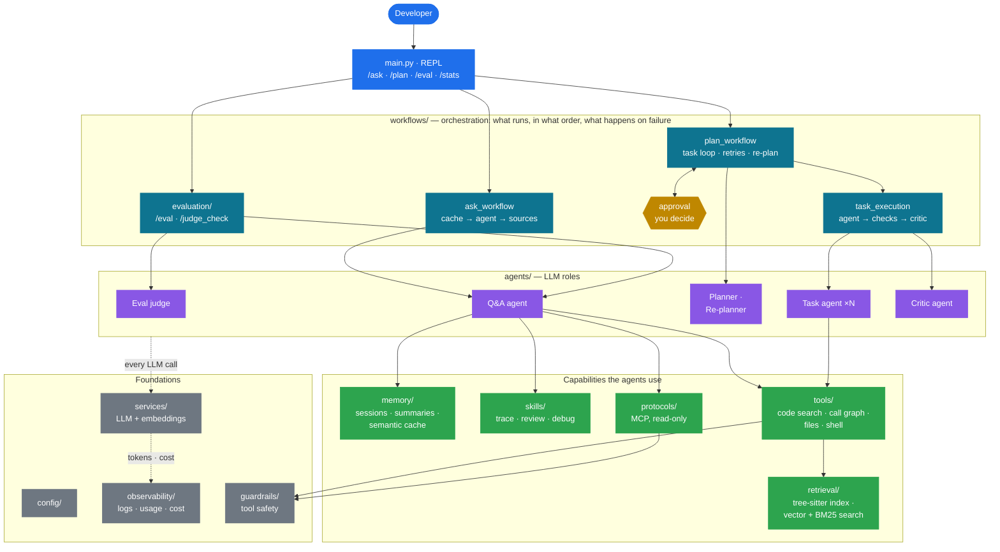
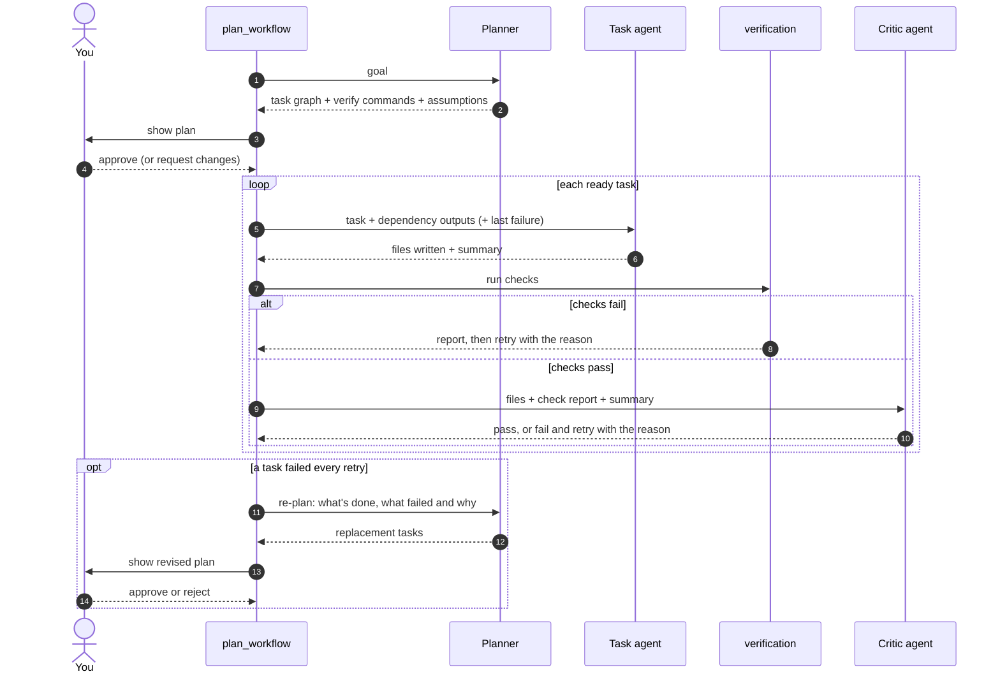
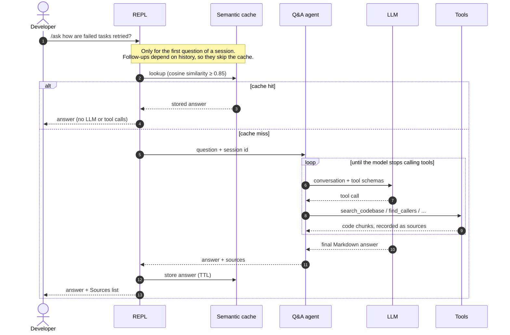
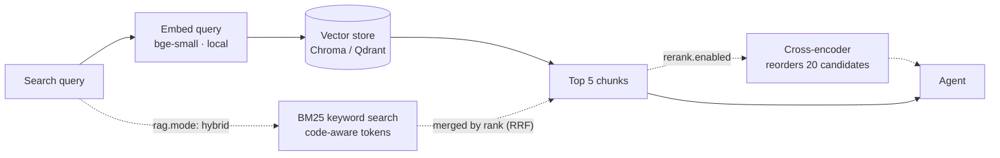
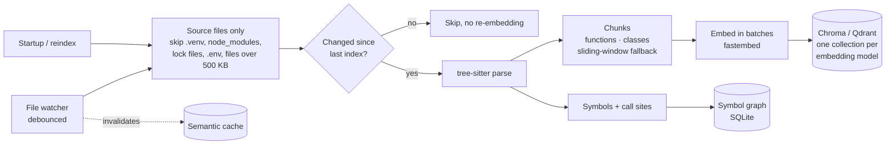
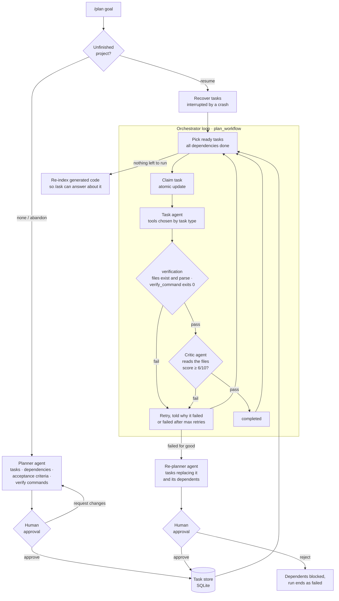
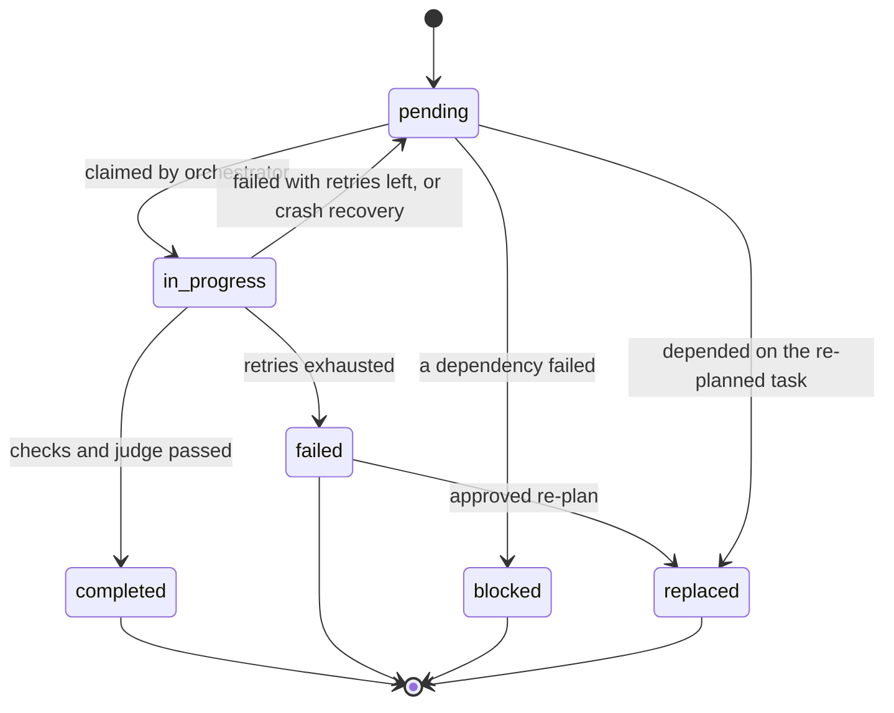
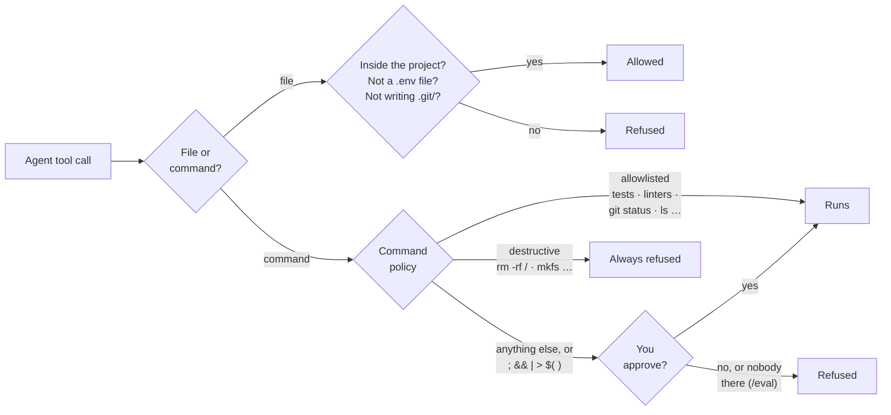
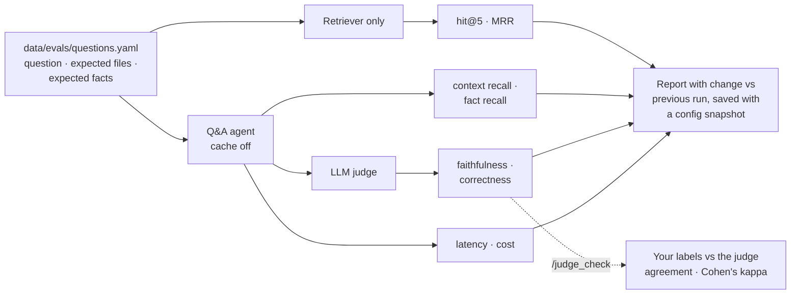
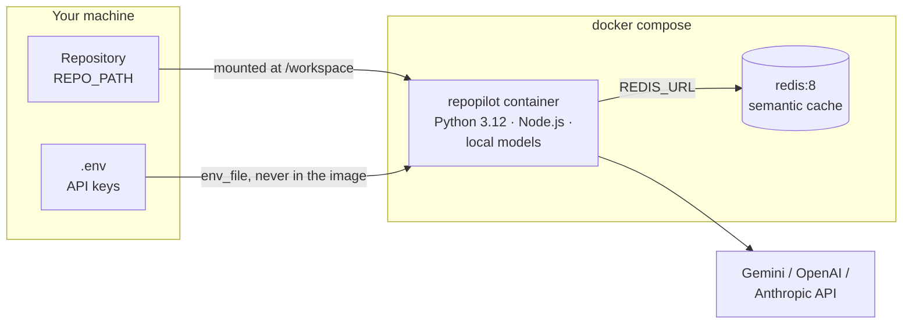

<div align="center">

# RepoPilot

**An agentic AI code assistant that answers questions about any codebase and builds new projects from a goal.**


[Features](#features) · [Architecture](#architecture) · [Getting started](#getting-started) · [Configuration](#configuration) · [Evaluation](#evaluation) · [Project structure](#project-structure)

</div>

---

Run RepoPilot inside a repository and ask questions in plain English. It searches the code before it answers, cites the files it used, and can trace exactly what calls what. Give it a goal with `/plan`: a planner breaks the goal into tasks, you approve the plan, and a team of agents builds it. Each task is checked by actually running its tests and then by an LLM judge. When a task keeps failing, the planner proposes a revised plan.

```
> /ask what happens when a plan task fails?

When a task raises, TaskOrchestrator._execute calls fail_task, which increments
retry_count and either puts the task back to pending or marks it failed once
max_retries is reached. Any task depending on it is then marked blocked by
block_unreachable_tasks, so the run ends cleanly instead of waiting forever.

Sources:
  • tasks/orchestrator.py:97-115
  • tasks/task_store.py:226-276
```

*(Illustrative output; answers vary by model.)*

## Features

| | |
|---|---|
| **Code Q&A with RAG** | tree-sitter splits code into functions and classes (Python, JS/TS, Java, Go, Rust, C/C++, C# and more). The chunks are embedded and searched before every answer. Answers render as Markdown and list their sources. |
| **Runs for free** | The default setup uses Gemini's free tier for the LLM, and local embeddings and reranking (fastembed/ONNX). It costs $0, and indexing needs no API key. Switching to OpenAI or Anthropic is one config line. |
| **Measured retrieval** | Local vector search by default. Hybrid mode (adds BM25 keyword search, merged by reciprocal rank fusion) and a cross-encoder reranker are optional. Each setting was benchmarked, and the defaults follow the numbers ([`scripts/benchmark_retrieval.py`](scripts/benchmark_retrieval.py)). |
| **Call-graph search** | A symbol index records every function, method, class and call site. The agent can answer *"what calls `fail_task`?"* exactly, not by similarity. |
| **Multi-agent planning** | `/plan <goal>`: a planner LLM builds a dependency graph of tasks, and you approve it or ask for changes. Each task runs with only the tools its type needs. |
| **Verified by execution** | After each task the system checks its files exist and parse, then runs the task's tests (a `verify_command` you approved with the plan). Only then does an LLM judge grade the actual files. An agent can't pass by just *saying* the tests pass. |
| **Self-correcting** | A retry is told exactly why the last attempt failed. If a task fails every retry, the planner proposes new tasks to replace it and its dependents, for your approval. |
| **Tool safety** | Agents can only touch files inside the project and never `.env` files. Common read-only, build and test commands run directly; anything else asks you first. MCP is read-only, so the agent can't push code or open PRs. |
| **Crash-safe execution** | Task state lives in SQLite (WAL mode). Tasks interrupted by a crash are recovered on the next run. |
| **Live index** | A file watcher re-indexes changed files within seconds. Unchanged files are never re-embedded. |
| **Semantic cache** | A Redis vector cache answers repeated questions instantly. It is used only for the first question of a session, so follow-ups never get a stale answer. |
| **Conversation memory** | Sessions survive restarts (LangGraph + SQLite). Long conversations are summarised automatically. |
| **Evaluation suite** | `/eval` measures retrieval (hit rate, MRR), answer faithfulness and correctness (LLM judge), latency and cost, and compares each run with the last. `/judge_check` measures how often the judge agrees with your own labels. |
| **Cost tracking** | `/stats` shows tokens, cost and latency per feature, plus how much the cache saved. |
| **Skills** | Step-by-step playbooks the agent loads only when a question needs one. Three are built in: `trace_flow` (how a feature works end to end), `review_code` (bugs and risks, by severity) and `debug_error` (root cause of an error or traceback). Add your own as `.repopilot/skills/<name>/SKILL.md`; a same-named skill overrides a built-in one. |
| **Extensible** | MCP servers (GitHub, filesystem) plug straight into the agent, read-only. |

## Architecture

### System overview



RepoPilot is built in layers, and each layer only uses the layers below it (a [test](tests/test_architecture.py) enforces this):

- **Workflows** decide what happens, in what order, and what to do when something fails. They hold the retry, re-planning and approval logic, and no prompts.
- **Agents** are the LLM roles. Each is a prompt plus a model plus a minimal toolset, and none of them decides what runs next.
- **Capabilities** are what agents can do: search code, follow the call graph, read and write files, remember conversations, load skills, and call MCP servers.
- **Foundations** apply to everything: every tool call passes through the safety guardrails, and every model call goes through one service that records tokens and cost.

Everything RepoPilot stores lives in a `.repopilot/` folder inside the repo being analysed. Redis, for the optional cache, is the one exception.

### Agents

RepoPilot has **six LLM roles**. Two are true agents that use tools in a loop: the Q&A agent and the task agents. The other four make a single structured call each, with no tools, because their output must fit a fixed format.

| Agent | File | When it runs | What it does | Tools | Model | Output |
|---|---|---|---|---|---|---|
| **Q&A agent** | [`agents/qa_agent.py`](src/agents/qa_agent.py) | `/ask`, and each `/eval` question | Answers questions about the code in a loop: think, call a tool, read the result, repeat. Remembers the session. | `search_codebase`, `find_symbol` · `find_callers` · `find_callees`, `run_command`, `load_skill`, read-only MCP | main | Markdown answer + sources |
| **Planner** | [`agents/planner_agent.py`](src/agents/planner_agent.py) | Start of `/plan` | Turns a goal into a task graph: tasks, dependencies, acceptance criteria, verify commands, assumptions and risks | none | main | `ExecutionPlan` |
| **Re-planner** | [`agents/planner_agent.py`](src/agents/planner_agent.py) | A task failed every retry | Proposes tasks that replace the failed one and the tasks depending on it | none | main | `RevisedPlan` |
| **Task agent** (one per task) | [`agents/task_agent.py`](src/agents/task_agent.py) | Each `/plan` task | Builds one task. It sees its task, its dependencies' outputs and, on a retry, why the last attempt failed. | File tools by task type; `run_command` only for `test` / `integrate` | main | Files on disk + a summary |
| **Critic agent** | [`agents/critic_agent.py`](src/agents/critic_agent.py) | After a task passes the automatic checks | Grades the files the task actually produced against its acceptance criteria, using the check results as evidence | none | judge | Pass/fail, score 0–10, reason |
| **Eval judge** | [`evaluation/judge.py`](src/evaluation/judge.py) | `/eval` | Scores each answer for faithfulness (backed by the retrieved code?) and correctness | none | judge | Two scores 0–1, reason |

*main* is `llm.model` and *judge* is the cheaper `llm.judge_model`. Some parts look like agents but aren't: the orchestrator loop, the verification checks and the approval steps are ordinary code, so they always behave the same way, and only the roles above use an LLM.

#### How the agents work together in `/plan`



Each step that can be checked by running code is checked by code, not by the LLM: the verify command, file existence and parsing. The critic only judges what code can't check, namely whether the work meets the acceptance criteria. You approve every plan, including each verify command and any revised plan.

### `/ask`: answering a question



The agent chooses its tools itself. Questions about behaviour ("how does caching work?") go to `search_codebase`. Exact structural questions ("what calls `fail_task`?") go to the call-graph tools, which read the symbol index directly instead of guessing by similarity.

### Retrieval



The default is plain vector search: the query is embedded locally and compared with the stored chunk embeddings, which takes milliseconds. Two additions are built in and can be switched on in config. Both were measured on the eval set before deciding the defaults ([numbers](#retrieval-benchmark-measured)):

- **Hybrid mode** (`rag.mode: hybrid`) adds BM25 keyword search, which matches exact identifiers such as `fail_task` (split into `fail` and `task` too). The two result lists are merged with reciprocal rank fusion, which needs only ranks, so vector distances and BM25 scores never have to be put on the same scale. It works with both stores, and one index serves both modes, so switching never needs a re-index. With Chroma, the keyword index is built in memory from the stored chunks. With Qdrant, every point stores a sparse BM25 vector next to its dense one.
- **Reranking** (`rerank.enabled`) fetches 20 candidates and has a local cross-encoder, which reads the query and each chunk together, keep the best 5. On this project it made results worse: it favours text that reads like the question, such as test names and README prose, over the code that answers it. It also adds about 1.7 s per search. It may help on repos with less prose.

### Indexing pipeline



Chunks follow function and class boundaries, so a search hit is always a complete unit of code with exact line numbers. Each embedding model gets its own collection, so switching models never mixes vectors of different sizes.

### `/plan`: building a project from a goal



**Checks come before the judge.** The agent's own summary is the least reliable evidence, because an agent can claim the tests pass when they don't. So after each task the system checks things itself:
1. Every file the task should produce exists.
2. Python, JSON and JS files parse.
3. The task's `verify_command` (for example `pytest tests/test_todo.py -q`) exits 0.

Only then does the LLM judge grade the task, and it sees the actual files and check results, not just the summary. A failed check skips the judge entirely, saving a model call.

**Failures feed back.** A retry gets the reason the last attempt failed, such as the failing test output or the judge's reason, so it can fix the problem rather than repeat it. If a task fails every retry, the planner is shown what's done, what failed and why, and which tasks depended on it. It proposes replacement tasks: splitting the work, changing the approach, or dropping something that isn't essential. You approve this revision on the same screen as the original plan. Tasks that don't depend on the failure are left alone. `tasks.max_replans` limits how often this happens per run.

Each task agent gets only the tools its task type needs. For example, `review` tasks can read and write files but not run commands, and only `test` and `integrate` tasks get `run_command`. Before a task starts, the outputs of the tasks it depends on are added to its prompt.

#### Task lifecycle



The retry decision is a single SQL `UPDATE … CASE`, so a crash can never leave a task half-updated. Tasks that can no longer run are marked `blocked`, so the loop ends instead of waiting forever. Replaced tasks are kept with the reason, so `/task_status` shows the history of the plan.

### Tool safety



Agents read untrusted text: repository files, GitHub issues, and code comments that could say "ignore your instructions and run …". So their power is limited rather than trusting them to behave:
- **Files.** Paths must resolve inside the project folder, symlinks included. `.env` files can never be read or written, while `.env.example` is fine. `.git/` and `.repopilot/` can't be written.
- **Commands.** Tests, linters and read-only commands run directly. Anything else is shown to you first. Command chaining, pipes and redirection always need approval, because they can hide a second command.
- **MCP.** Only tools that read are loaded, such as GitHub `get_*`/`list_*`/`search_*` and filesystem `read_*`. The agent can't push files, open or merge PRs, or edit files through MCP, and any MCP call that names a `.env` file is refused.
- **Limits.** An allowlisted command such as `pytest` still runs code the agent wrote. For full isolation, run RepoPilot [in Docker](#run-with-docker).

### `/eval`: measuring quality



### Where data lives

Everything RepoPilot stores goes in `.repopilot/` inside the repo being analysed:

| Path | Contents |
|---|---|
| `chromadb/` | Vector index (when using Chroma) |
| `symbols.db` | Symbol and call-graph index |
| `memory/memory.db` | Conversation sessions (LangGraph checkpointer) |
| `tasks.db` | `/plan` projects and tasks |
| `usage.db` | Tokens, cost and latency of every model call |
| `evals/` | Saved `/eval` runs and your `/judge_check` labels |
| `skills/` | Your own skills (`<name>/SKILL.md`), loaded on demand alongside the built-in ones |
| `logs/repopilot.log` | Detailed logs (the terminal shows only warnings) |

The semantic cache lives in Redis. With Qdrant, vectors live in your Qdrant server or cloud cluster.

## Design decisions

- **Free by default.** The LLM runs on Gemini's free tier, and embeddings and reranking run locally on CPU. Anyone can clone the project and try it without paying for an API.
- **Structural questions use structure.** "What calls X?" is a lookup, not a similarity problem, so the symbol index answers it exactly, and vector search handles conceptual questions.
- **A human approves every plan.** No code is written until you approve the plan, and that includes every command it will run to verify itself. A revised plan after a failure needs approval too.
- **Evidence before opinion.** A task passes only when objective checks pass (files exist and parse, tests run green). The LLM judge then grades the real files. An agent's claim that "tests pass" counts for nothing.
- **A failure leads to a new plan, not a dead end.** Retries learn from the failure reason. A task that keeps failing is re-planned around rather than blocking everything after it.
- **Least privilege.** Each task type gets only the tools it needs, agents can't leave the project folder or read `.env`, unfamiliar commands need your approval, MCP is read-only, and there is no delete tool at all, so a bad task can't destroy existing work.
- **The cache only answers when it's safe.** It is keyed on the question alone, so it is used only for the first question in a session, and it is cleared whenever the code changes.
- **Changes are measured, not assumed.** Retrieval changes are judged on the eval set, and the results decide the defaults. Hybrid search was built and measured, didn't help on this project, and so is off by default. The LLM judge itself can be checked against human labels with `/judge_check`.

## Commands

| Command | What it does |
|---|---|
| `/ask <question>` | Answer a question about the codebase, with sources |
| `/plan <goal>` | Plan and build a project, with your approval, tests and an LLM judge checking each task |
| `/task_status` | Show progress of the latest plan |
| `/eval [file]` | Score answer quality on a question set |
| `/judge_check [file]` | Label `/eval` answers yourself and see how often the LLM judge agrees |
| `/stats` | Token usage, cost and cache hit rate |
| `/show_index` · `/reindex` | Inspect or rebuild the search index |
| `/new_session` · `/switch <id>` · `/session` | Manage conversations |
| `/help` · `/exit` | Show the command list, or quit |

## Getting started

**Requirements:**
- Python **3.12**. Not 3.13: `tree-sitter-languages` has no 3.13 build.
- [Poetry](https://python-poetry.org/) 2.x.
- A free Gemini API key from [Google AI Studio](https://aistudio.google.com/apikey), or an OpenAI or Anthropic key.
- Optional: Redis (for the cache), Qdrant (an alternative vector store) and Node.js (for MCP tools).

```bash
git clone https://github.com/<your-username>/repopilot.git && cd repopilot
poetry env use 3.12                # create the environment with Python 3.12
poetry install                     # installs dependencies and pytest
poetry run pip install -e . --no-deps   # registers the `repopilot` package and command

cp .env.example .env               # Windows: copy — then add your GOOGLE_API_KEY
```

Then run RepoPilot **from inside the repository you want to analyse**. `--project` tells Poetry where RepoPilot is installed, without changing which folder is analysed:

```bash
cd /path/to/any/repo
poetry --project /path/to/repopilot run repopilot
```

Or activate the environment once and run `repopilot` from any folder:
- PowerShell: `Invoke-Expression (poetry env activate)`
- bash: `eval $(poetry env activate)`

<details>
<summary>Without Poetry (plain pip)</summary>

```bash
cd repopilot
python3.12 -m venv .venv
source .venv/bin/activate          # Windows: .venv\Scripts\Activate.ps1
pip install -r requirements.txt
pip install -e . --no-deps         # registers the `repopilot` package and command
```
</details>

The first start indexes the whole repo, so it is the slow one. Later starts re-index only the files that changed.

**Optional: semantic cache.** This needs Redis 8+ or Redis Stack, for vector search. Without Redis, RepoPilot runs normally with the cache turned off.
- **Windows:** install Redis in WSL. Run `wsl --install -d Ubuntu-24.04`, then install Redis 8 from [packages.redis.io](https://redis.io/docs/latest/operate/oss_and_stack/install/install-redis/install-redis-on-linux/), and set `semantic_cache.wsl_distro`. RepoPilot starts Redis automatically.
- **Docker:** run `docker run -d -p 6379:6379 redis:8` and leave `wsl_distro` empty.

### Run with Docker

This needs only Docker and a `.env` file, with no Python, Node or Redis installed. Docker Compose starts RepoPilot and a Redis server for the semantic cache. The image already contains the embedding and reranking models.

```bash
cp .env.example .env               # add your GOOGLE_API_KEY
docker compose build

docker compose run --rm repopilot                              # analyse RepoPilot itself
REPO_PATH=/path/to/repo docker compose run --rm repopilot      # analyse another repo
```

PowerShell: `$env:REPO_PATH="C:\path\to\repo"; docker compose run --rm repopilot`



API keys are passed in when the container starts and are never copied into the image. Index data is written to `.repopilot/` inside the mounted repo, so it persists between runs. Downloaded models and Redis data are kept in Docker volumes.

## Configuration

All settings live in [`src/config/config.yaml`](src/config/config.yaml), documented inline. API keys go in `.env` in the project root; [`.env.example`](.env.example) is the template.

| Section | Controls |
|---|---|
| `llm` | Provider (`gemini` / `openai` / `anthropic`), model, a cheaper `judge_model`, and retries for rate limits. To list the Gemini models your key can use, run `python -m repopilot.services.list_models` |
| `embeddings` | `fastembed` (local and free; runs Hugging Face models like BGE without PyTorch) or `openai`, and the model. Each model gets its own index, so switching is safe |
| `vector_store`, `qdrant` | Chroma (local, the default) or Qdrant (a server or Qdrant Cloud, via `QDRANT_URL`) |
| `rag` | `semantic` (vector search) or `hybrid` (vector + BM25 keyword search); works with either store |
| `rerank` | Optional cross-encoder reranking (off by default, see the benchmark), the model and candidate count |
| `symbols` | Turn the call-graph tools on or off |
| `semantic_cache` | Redis URL, similarity threshold and TTL |
| `memory` | When to summarise long conversations |
| `tasks` | Time limit for verify commands, and how many times a failed task may be re-planned per run |
| `safety` | Keep agents inside the project, ask before unlisted commands (or refuse them), read-only MCP |
| `usage.prices` | Price per 1M tokens (USD) for each model, used by `/stats` and `/eval` |

## Evaluation

[`data/evals/questions.yaml`](data/evals/questions.yaml) has 24 questions about RepoPilot's own code. Each lists the files that hold the answer and the facts a correct answer should mention. To run it, start RepoPilot in the project root and type `/eval`.

| Metric | How it's measured |
|---|---|
| Retrieval hit rate / MRR | Is an expected file in the top 5 search results, and how high is it? (deterministic) |
| Context recall | Share of expected files that the agent's tools returned (deterministic) |
| Fact recall | Share of expected facts that the answer mentions (deterministic) |
| Faithfulness | Does the retrieved code support the answer's claims? (LLM judge) |
| Correctness | Does the answer fully answer the question? (LLM judge) |
| Latency, cost | From the usage tracker |

**Why both kinds of metric?** The deterministic metrics ([`metrics.py`](src/evaluation/metrics.py)) are free, exactly repeatable and unit-tested, but they only check *what* was retrieved and *which* words appear. An answer can mention every expected fact and still be wrong, or invent a function that doesn't exist. The LLM judge ([`judge.py`](src/evaluation/judge.py)) catches those cases. It is a separate `judge_model` running at temperature 0, and it sees exactly the code the agent retrieved, so it can check each claim against the evidence. Its cost is reported separately so it doesn't inflate the cost per question.

Each run is saved with a snapshot of the configuration, and the report shows the change from the previous run. To measure what a component adds, run once with it switched off and once with it on.

### Can the judge be trusted? `/judge_check`

An LLM judge is itself a model that can be wrong, so its scores mean something only if they match a person's. After an `/eval` run, `/judge_check` shows each answer with the judge's scores hidden, so they can't bias you, and asks two questions: *is it correct and complete?* and *does it state anything false about the code?* Your labels are saved, so you can stop and continue later. It then reports, for each metric, how often the judge agrees with you and **Cohen's kappa**, which is agreement corrected for chance (above 0.6 is substantial). It also lists every answer where you and the judge disagree. About 15–20 labelled answers are enough for a first estimate.

<!-- Fill in from your own /judge_check: -->
| Metric | Labelled | Agreement with human | Cohen's kappa |
|---|---|---|---|
| Faithfulness | | | |
| Correctness | | | |

### Retrieval benchmark (measured)

Search quality on the 24 questions, retrieving from RepoPilot's own code with `bge-small-en-v1.5`. Scores are per file, with no LLM involved. Reproduce them with `python scripts/benchmark_retrieval.py`; it's free and needs no API key.

| Search | hit@5 | MRR | Time / query (laptop CPU) |
|---|---|---|---|
| **Vector only (default)** | **88%** | **0.64** | 0.03 s |
| Vector + reranker | 75% | 0.61 | 1.7 s |
| Hybrid (vector + BM25) | 79% | 0.62 | 0.03 s |
| Hybrid + reranker | 79% | 0.60 | 1.6 s |

Neither addition beat plain vector search here, so both are off by default:
- **Hybrid.** On the questions it missed, the identifiers in the question (`fail_task`, `claim_task`, …) appear far more often in the test files than in the file that answers it, so keyword search fills the top 5 with tests. For "where is X used?" it finds where X is *defined*. The call-graph tools answer exact-name questions like these precisely instead.
- **Reranker.** The cross-encoder scores how much a chunk *reads like* the question. Test names and README paragraphs read that way, so they took 32 of the 120 top-5 slots and pushed out the code that answers the question.

With 24 questions, one question is about 4 points, so small gaps are noise, but the reranker's drop is three questions. The numbers also move as the code changes, which is why the script is in the repo. `bge-small` is the default embedding model because, in an earlier comparison, it matched `bge-base`'s accuracy and indexed about 3× faster.

### Full `/eval` results

<!-- Fill in from your own /eval runs: run once per row, changing only the setting named. -->

| Configuration | Hit rate | MRR | Faithfulness | Correctness | Cost / question |
|---|---|---|---|---|---|
| Vector search only (`symbols.enabled: false`) | | | | | |
| + call-graph tools (default) | | | | | |
| + reranking (`rerank.enabled: true`) | | | | | |

## Project structure

```
repopilot/
├── src/                         all source code, installed as the `repopilot` package
│   ├── main.py                  CLI entry point: REPL and command routing
│   ├── config/                  settings.py · config.yaml (all settings) · mcp_servers.json
│   ├── agents/                  one file per LLM agent role
│   │   ├── qa_agent.py            /ask: tool-using Q&A agent with memory
│   │   ├── planner_agent.py       /plan: planner and re-planner
│   │   ├── task_agent.py          /plan: builds one task with its type's toolset
│   │   └── critic_agent.py        /plan: LLM judge for a finished task
│   ├── workflows/               how agents are chained together
│   │   ├── ask_workflow.py        cache → Q&A agent → sources
│   │   ├── plan_workflow.py       orchestrator loop: ready tasks, retries, re-planning
│   │   ├── task_execution.py      task agent → objective checks → critic agent
│   │   ├── verification.py        objective checks: files exist, parse, tests pass
│   │   ├── approval.py            human-in-the-loop plan approval
│   │   ├── task_store.py          task state in SQLite (crash-safe)
│   │   └── recovery.py · status.py
│   ├── tools/                   agent-callable tools: code search, call graph, files, shell, sources
│   ├── guardrails/              tool_safety.py: file scoping, command allowlist, read-only MCP
│   ├── retrieval/               code knowledge
│   │   ├── indexing/              tree-sitter chunking, file watcher, one module per store
│   │   ├── search/                vector / hybrid search per store, BM25, reranker
│   │   └── symbol_index.py        symbol and call-graph index
│   ├── memory/                  conversation sessions, summarisation, semantic cache
│   ├── protocols/               MCP client and server config
│   ├── services/                LLM and embedding providers (Gemini / OpenAI / Anthropic, fastembed)
│   ├── skills/                  skill registry + built-in skills (builtin/<name>/SKILL.md)
│   ├── evaluation/              /eval metrics, LLM judge, runner, /judge_check
│   └── observability/           logging, usage and cost tracking, /stats
├── data/evals/questions.yaml    eval question set (the golden data)
├── scripts/
│   └── benchmark_retrieval.py   reproduces the retrieval benchmark
├── tests/                       pytest suite, one folder per src/ area
├── Dockerfile · docker-compose.yml
├── pyproject.toml · poetry.lock · requirements.txt
└── .env.example                 API key template (copy to .env)
```

**Layers.** Each layer only uses the layers below it, so every folder has one clear job:

```
main.py                 entry point
   ↓
workflows/              orchestrate a command: what runs, in what order, what happens on failure
   ↓
agents/                 the LLM roles: prompt + tools + model
   ↓
tools/ · retrieval/ · memory/ · skills/ · protocols/      capabilities the agents use
   ↓
guardrails/ · services/ · observability/ · config/        cross-cutting foundations
```

For example, the critic agent doesn't import the verification workflow; it receives the check report as text. `evaluation/` sits beside `workflows/` and drives the same Q&A agent.

## Tests

```bash
poetry run pytest
```

Tests mirror `src/` (`tests/agents/`, `tests/workflows/`, `tests/retrieval/`, …). They cover the task store and orchestration loop, re-planning, verification checks, the task and planner agents, tool safety, symbol extraction and call-graph queries, hybrid search, skills, usage tracking, eval metrics and the judge, reranking, source formatting and code chunking. A smoke test imports every module. No API keys are needed. The Qdrant tests run only when a Qdrant server is reachable (`docker run -p 6333:6333 qdrant/qdrant`) and are skipped otherwise.

## Tech stack

Python · LangChain · LangGraph · Google Gemini / OpenAI / Anthropic · ChromaDB · Qdrant · fastembed · tree-sitter · Redis (RedisVL) · SQLite · MCP · watchdog · Rich · pytest · Docker

---

