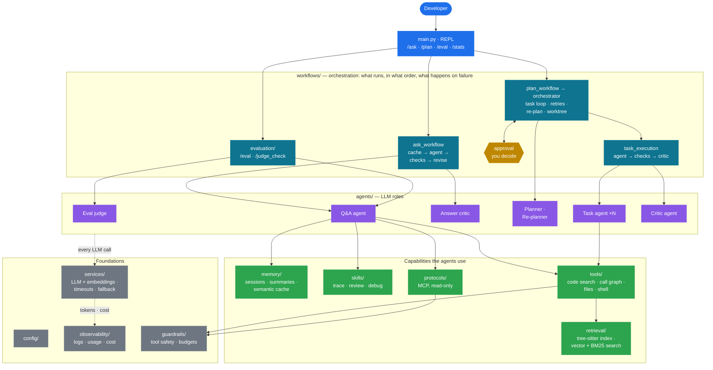
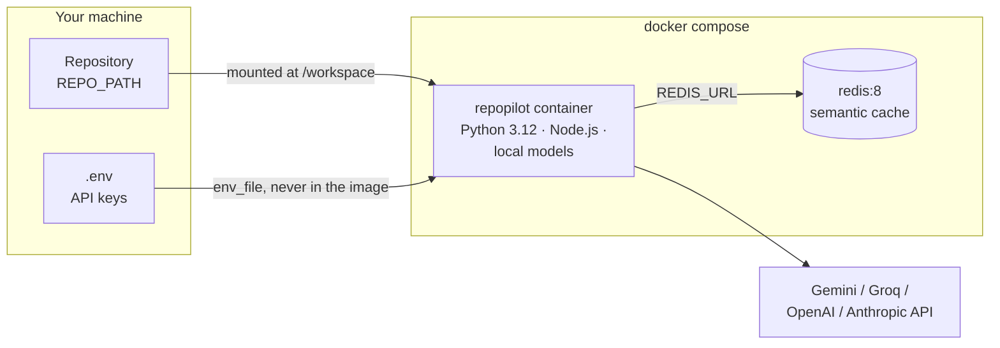

<div align="center">

# RepoPilot

**An agentic AI code assistant that answers questions about any codebase and builds new projects from a goal.**


[](https://github.com/Parth-Babariya/RepoPilot/actions/workflows/ci.yml)


[Features](#features) · [Results](#results) · [Architecture](#architecture) · [Getting started](#getting-started) · [Configuration](#configuration) · [Docs](#documentation)

</div>

---

Run RepoPilot inside a repository and ask questions in plain English. It searches the code before it answers, cites the files it used, and can trace exactly what calls what. Give it a goal with `/plan`: a planner breaks the goal into tasks, you approve the plan, and a team of agents builds it. Each task is checked by actually running its tests and then by an LLM judge. When a task keeps failing, the planner proposes a revised plan. The plan works in its own git worktree, so nothing reaches your checkout until you've seen the diff. Answers to `/ask` are checked before you see them.

```
> /ask what happens when a plan task fails?

When a task raises, TaskOrchestrator._execute calls fail_task, which increments
retry_count and either puts the task back to pending or marks it failed once
max_retries is reached. Any task depending on it is then marked blocked by
block_unreachable_tasks, so the run ends cleanly instead of waiting forever.

Sources:
  • src/workflows/orchestrator.py:122-151
  • src/workflows/task_store.py:266-333

✓ Checked: 2 file references valid · claims supported by the retrieved code
```

*(Illustrative output; answers vary by model.)*

## Features

| | |
|---|---|
| **Code Q&A with RAG** | tree-sitter splits code into functions and classes (Python, JS/TS, Java, Go, Rust, C/C++, C# and more). The chunks are embedded and searched before every answer. Answers render as Markdown and list their sources. |
| **Runs for free** | The default setup uses Gemini's free tier for the LLM, and local embeddings and reranking (fastembed/ONNX). It costs $0, and indexing needs no API key. Groq (also free, and much faster) is built in too, and works well as the judge model next to Gemini (`judge_model: groq:openai/gpt-oss-20b`), which spreads calls over two free quotas. Switching to OpenAI or Anthropic is one config line. |
| **Measured retrieval** | Hybrid search by default: local vector search plus BM25 keyword search, merged by reciprocal rank fusion. Plain vector search and a cross-encoder reranker are options. Each setting was benchmarked, and the defaults follow the numbers ([`scripts/benchmark_retrieval.py`](scripts/benchmark_retrieval.py)). |
| **Call-graph search** | A symbol index records every function, method, class and call site. The agent can answer *"what calls `fail_task`?"* exactly, not by similarity. |
| **Multi-agent planning** | `/plan <goal>`: a planner LLM builds a dependency graph of tasks, and you approve it or ask for changes. Each task runs with only the tools its type needs. |
| **Verified by execution** | After each task the system checks its files exist and parse, then runs the task's tests (a `verify_command` you approved with the plan). Only then does an LLM judge grade the actual files. An agent can't pass by just *saying* the tests pass. |
| **Self-correcting** | A retry is told exactly why the last attempt failed. If a task fails every retry, the planner proposes new tasks to replace it and its dependents, for your approval. |
| **Self-checking answers** | Before an `/ask` answer is shown, code checks that every file and line it cites exists, then a cheap judge model checks its claims against the code the agent actually retrieved. An answer that fails is sent back once, with the problems listed. |
| **Isolated execution** | `/plan` works in a separate git worktree on its own branch. When it finishes you see the diff and choose: apply it to your checkout (staged, not committed), keep the branch, or discard it. |
| **Budgets and resilience** | Every agent has a tool-call and model-call limit, and every `/ask` and `/plan` a token budget. A limit stops work cleanly, and a paused `/plan` resumes later. Model calls time out, retry with backoff, and switch to a fallback model if the main one keeps failing. |
| **Tool safety** | Agents can only touch files inside the project and never `.env` files. Common read-only, build and test commands run directly; anything else asks you first. MCP is read-only, so the agent can't push code or open PRs. |
| **Crash-safe execution** | Task state lives in SQLite (WAL mode). Tasks interrupted by a crash are recovered on the next run. |
| **Live index** | A file watcher re-indexes changed files within seconds. Unchanged files are never re-embedded. |
| **Semantic cache** | A Redis vector cache answers repeated questions instantly. It is used only for the first question of a session, so follow-ups never get a stale answer. |
| **Conversation memory** | Sessions survive restarts (LangGraph + SQLite). Long conversations are summarised automatically. |
| **Evaluation suite** | `/eval` measures retrieval (hit rate, MRR), answer faithfulness and correctness (LLM judge), latency and cost, and compares each run with the last. `/judge_check` measures how often the judge agrees with your own labels. |
| **Cost tracking** | `/stats` shows tokens, cost and latency per feature, plus how much the cache saved. |
| **Skills** | Step-by-step playbooks the agent loads only when a question needs one. Three are built in: `trace_flow` (how a feature works end to end), `review_code` (bugs and risks, by severity) and `debug_error` (root cause of an error or traceback). Add your own as `.repopilot/skills/<name>/SKILL.md`; a same-named skill overrides a built-in one. |
| **Extensible** | MCP servers (GitHub, filesystem) plug straight into the agent, read-only. |

## Results

Measured with `/eval` on 24 questions about RepoPilot's own code (2026-10-18), agent `gemini-3.5-flash-lite`, judge `openai/gpt-oss-20b` on Groq, all on free tiers:

| Retrieval hit rate | MRR | Faithfulness | Correctness | Answer time (median / mean) | Cost |
|---|---|---|---|---|---|
| 92% | 0.72 | 0.98 | 0.96 | 3.1 s / 4.5 s | $0 |

All 24 questions answered, 22 of them scoring ≥ 0.9 on both judge metrics. Mean answer time fell from 17.2 s to 4.5 s after three changes that cut model calls per answer: one search before the agent starts, indexing module-level code, and a guard against repeated searches. Part of the judge-score gain since the previous run comes from a judge fix; the [evaluation doc](docs/evaluation.md) has the caveat, the retrieval benchmark and how every default was chosen.

## Architecture



Each layer only uses the layers below it, and a [test](tests/test_architecture.py) enforces this:
- **Workflows** decide what runs, in what order, and what happens on failure. They hold no prompts.
- **Agents** are the LLM roles: a prompt, a model and a minimal toolset. None of them decides what runs next.
- **Capabilities** are what agents can do: search code, follow the call graph, read and write files, remember, load skills, call MCP.
- **Foundations** wrap everything: tool-safety guardrails, step and token budgets, and one LLM service with timeouts, retries, a fallback model and cost tracking.

**Seven LLM roles.** Two are true agents that use tools in a loop: the **Q&A agent** (`/ask`) and the **task agents** (one per `/plan` task). Five make one structured call each: the **answer critic** (checks `/ask` answers), the **planner** and **re-planner**, the **critic** (grades finished tasks) and the **eval judge**.

[docs/architecture.md](docs/architecture.md) walks through each one: `/ask` and `/plan` step by step, retrieval and indexing, the task lifecycle, tool safety, budgets, and the design decisions.

## Commands

| Command | What it does |
|---|---|
| `/ask <question>` | Answer a question about the codebase, with sources |
| `/plan <goal>` | Plan and build a project, with your approval, tests and an LLM judge checking each task |
| `/task_status` | Show progress of the latest plan |
| `/eval [file]` | Score answer quality on a question set |
| `/judge_check [file]` | Label `/eval` answers yourself and see how often the LLM judge agrees |
| `/stats` | Token usage, cost and cache hit rate |
| `/show_index` · `/reindex` | Inspect or rebuild the search index |
| `/new_session` · `/switch <id>` · `/session` | Manage conversations |
| `/help` · `/exit` | Show the command list, or quit |

## Getting started

**Requirements:**
- Python **3.12**. Not 3.13: `tree-sitter-languages` has no 3.13 build.
- [Poetry](https://python-poetry.org/) 2.x.
- A free Gemini API key from [Google AI Studio](https://aistudio.google.com/apikey), or an OpenAI or Anthropic key.
- Optional: Redis (for the cache), Qdrant (an alternative vector store) and Node.js (for MCP tools).

```bash
git clone https://github.com/Parth-Babariya/RepoPilot.git && cd RepoPilot
poetry env use 3.12                # create the environment with Python 3.12
poetry install                     # installs dependencies and pytest
poetry run pip install -e . --no-deps   # registers the `repopilot` package and command

cp .env.example .env               # Windows: copy — then add your GOOGLE_API_KEY
```

Then run RepoPilot **from inside the repository you want to analyse**. `--project` tells Poetry where RepoPilot is installed, without changing which folder is analysed:

```bash
cd /path/to/any/repo
poetry --project /path/to/RepoPilot run repopilot
```

Or activate the environment once and run `repopilot` from any folder:
- PowerShell: `Invoke-Expression (poetry env activate)`
- bash: `eval $(poetry env activate)`

<details>
<summary>Without Poetry (plain pip)</summary>

```bash
cd RepoPilot
python3.12 -m venv .venv
source .venv/bin/activate          # Windows: .venv\Scripts\Activate.ps1
pip install -r requirements.txt
pip install -e . --no-deps         # registers the `repopilot` package and command
```
</details>

The first start indexes the whole repo, so it is the slow one. Later starts re-index only the files that changed.

**Optional: semantic cache.** This needs Redis 8+ or Redis Stack, for vector search. Without Redis, RepoPilot runs normally with the cache turned off.
- **Windows:** install Redis in WSL. Run `wsl --install -d Ubuntu-24.04`, then install Redis 8 from [packages.redis.io](https://redis.io/docs/latest/operate/oss_and_stack/install/install-redis/install-redis-on-linux/), and set `semantic_cache.wsl_distro`. RepoPilot starts Redis automatically.
- **Docker:** run `docker run -d -p 6379:6379 redis:8` and leave `wsl_distro` empty.

### Run with Docker

This needs only Docker and a `.env` file, with no Python, Node or Redis installed. Docker Compose starts RepoPilot and a Redis server for the semantic cache. The image already contains the embedding and reranking models.

```bash
cp .env.example .env               # add your GOOGLE_API_KEY
docker compose build

docker compose run --rm repopilot                              # analyse RepoPilot itself
REPO_PATH=/path/to/repo docker compose run --rm repopilot      # analyse another repo
```

PowerShell: `$env:REPO_PATH="C:\path\to\repo"; docker compose run --rm repopilot`



API keys are passed in when the container starts and are never copied into the image. Index data is written to `.repopilot/` inside the mounted repo, so it persists between runs. Downloaded models and Redis data are kept in Docker volumes.

## Configuration

All settings live in [`src/config/config.yaml`](src/config/config.yaml), documented inline. API keys go in `.env` in the project root; [`.env.example`](.env.example) is the template.

| Section | Controls |
|---|---|
| `llm` | Provider (`gemini` / `groq` / `openai` / `anthropic`), model, a cheaper `judge_model`, retries, a timeout and a `fallback_model` (which can use another provider: `gemini:gemini-3.5-flash`). To list the Gemini models your key can use, run `python -m repopilot.services.list_models` |
| `embeddings` | `fastembed` (local and free; runs Hugging Face models like BGE without PyTorch) or `openai`, and the model. Each model gets its own index, so switching is safe |
| `vector_store`, `qdrant` | Chroma (local, the default) or Qdrant (a server or Qdrant Cloud, via `QDRANT_URL`) |
| `rag` | `hybrid` (vector + BM25 keyword search, the default) or `semantic` (vector search only); works with either store |
| `rerank` | Optional cross-encoder reranking (off by default, see the benchmark), the model and candidate count |
| `symbols` | Turn the call-graph tools on or off |
| `semantic_cache` | Redis URL, similarity threshold and TTL |
| `memory` | When to summarise long conversations |
| `tasks` | Time limit for verify commands, how many times a failed task may be re-planned per run, and worktree isolation (`worktree` / `none`) |
| `ask` | The initial search before the agent starts, answer checks on or off, whether the LLM grounding check runs, and how many revisions |
| `budgets` | Tool-call and model-call limits per agent run, and token budgets per `/ask` and `/plan` |
| `safety` | Keep agents inside the project, ask before unlisted commands (or refuse them), read-only MCP |
| `usage.prices` | Price per 1M tokens (USD) for each model, used by `/stats` and `/eval` |

## Project structure

```
RepoPilot/
├── src/                         all source code, installed as the `repopilot` package
│   ├── main.py                  CLI entry point: REPL and command routing
│   ├── config/                  settings.py · config.yaml (all settings) · mcp_servers.json
│   ├── agents/                  one file per LLM agent role
│   │   ├── qa_agent.py            /ask: tool-using Q&A agent with memory
│   │   ├── answer_critic.py       /ask: checks an answer's claims against the retrieved code
│   │   ├── planner_agent.py       /plan: planner and re-planner
│   │   ├── task_agent.py          /plan: builds one task with its type's toolset
│   │   └── critic_agent.py        /plan: LLM judge for a finished task
│   ├── workflows/               how agents are chained together
│   │   ├── ask_workflow.py        cache → Q&A agent → answer checks → one revision
│   │   ├── answer_verification.py citation checks → answer critic
│   │   ├── plan_workflow.py       /plan entry: plan → approval → orchestrator → diff review
│   │   ├── orchestrator.py        task loop: ready tasks, retries, re-planning, budget pauses
│   │   ├── task_execution.py      task agent → objective checks → critic agent
│   │   ├── verification.py        objective checks: files exist, parse, tests pass
│   │   ├── approval.py            human-in-the-loop plan approval
│   │   ├── worktree.py            /plan isolation: git worktree, diff review, apply/keep/discard
│   │   ├── task_store.py          task state in SQLite (crash-safe)
│   │   └── recovery.py · status.py
│   ├── tools/                   agent-callable tools: code search, call graph, repo map, line reads, files, shell
│   ├── guardrails/              tool_safety.py: file scoping, command allowlist, read-only MCP ·
│   │                            budgets.py: step limits and token budgets
│   ├── retrieval/               code knowledge
│   │   ├── indexing/              tree-sitter chunking, file watcher, one module per store
│   │   ├── search/                vector / hybrid search per store, BM25, reranker
│   │   ├── symbol_index.py        symbol and call-graph index
│   │   └── repo_map.py            repository outline for the planner and the repo_map tool
│   ├── memory/                  conversation sessions, summarisation, semantic cache
│   ├── protocols/               MCP client and server config
│   ├── services/                LLM and embedding providers (Gemini / Groq / OpenAI / Anthropic, fastembed)
│   ├── skills/                  skill registry + built-in skills (builtin/<name>/SKILL.md)
│   ├── evaluation/              /eval metrics, LLM judge, runner, /judge_check
│   └── observability/           logging, usage and cost tracking, /stats
├── docs/                        architecture.md · evaluation.md
├── data/evals/questions.yaml    eval question set (the golden data)
├── scripts/
│   └── benchmark_retrieval.py   reproduces the retrieval benchmark
├── tests/                       pytest suite, one folder per src/ area
├── Dockerfile · docker-compose.yml
├── pyproject.toml · poetry.lock · requirements.txt
└── .env.example                 API key template (copy to .env)
```

## Tests

```bash
poetry run pytest
poetry run ruff check && poetry run ruff format --check   # lint and formatting
```

Tests mirror `src/` (`tests/agents/`, `tests/workflows/`, `tests/retrieval/`, …). They cover the task store and orchestration loop, re-planning, budget pauses, verification checks, worktree isolation (against a real temporary git repo), answer checks and the revision loop, the task and planner agents, tool safety and token budgets, symbol extraction and call-graph queries, hybrid search, skills, usage tracking, eval metrics and the judge, reranking, source formatting and code chunking. A smoke test imports every module. No API keys are needed. The Qdrant tests run only when a Qdrant server is reachable and are skipped otherwise. Start one with `docker run -p 6333:6333 qdrant/qdrant`, or without Docker by running the `qdrant` binary from [Qdrant's releases](https://github.com/qdrant/qdrant/releases).

CI ([.github/workflows/ci.yml](.github/workflows/ci.yml)) runs on every push and pull request: ruff lint and format checks, the full test suite with a Qdrant server so no test is skipped, and a Docker image build.

## Documentation

| Document | Contents |
|---|---|
| [docs/architecture.md](docs/architecture.md) | Layers, the seven agents, `/ask` and `/plan` flows, retrieval, indexing, task lifecycle, tool safety, budgets, where data lives, design decisions |
| [docs/evaluation.md](docs/evaluation.md) | Metrics, `/judge_check`, retrieval benchmark, full `/eval` results and what each run exposed |

## Tech stack

Python · LangChain · LangGraph · Google Gemini / Groq / OpenAI / Anthropic · ChromaDB · Qdrant · fastembed · tree-sitter · Redis (RedisVL) · SQLite · MCP · watchdog · Rich · pytest · Docker
