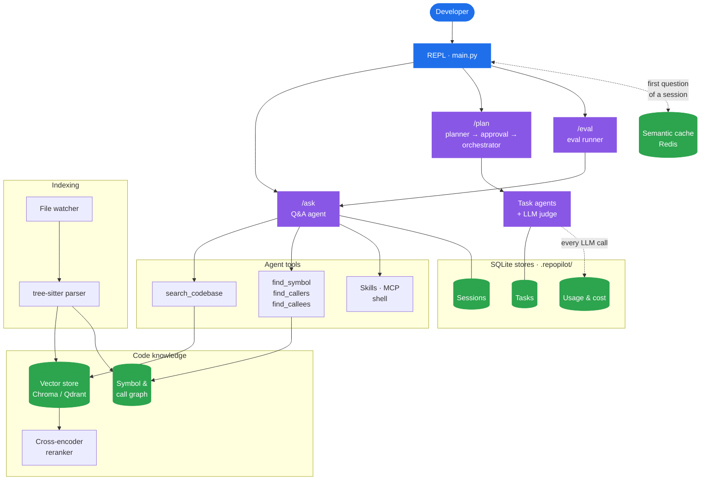
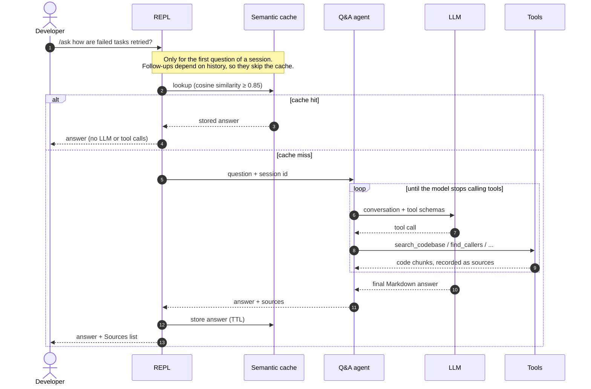
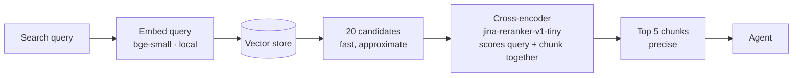
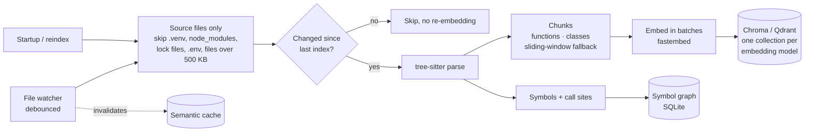
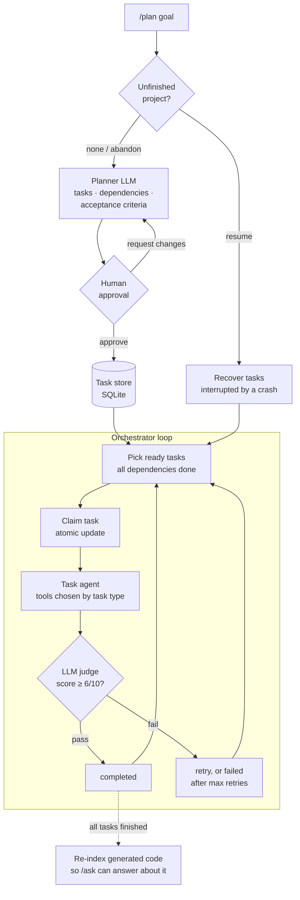
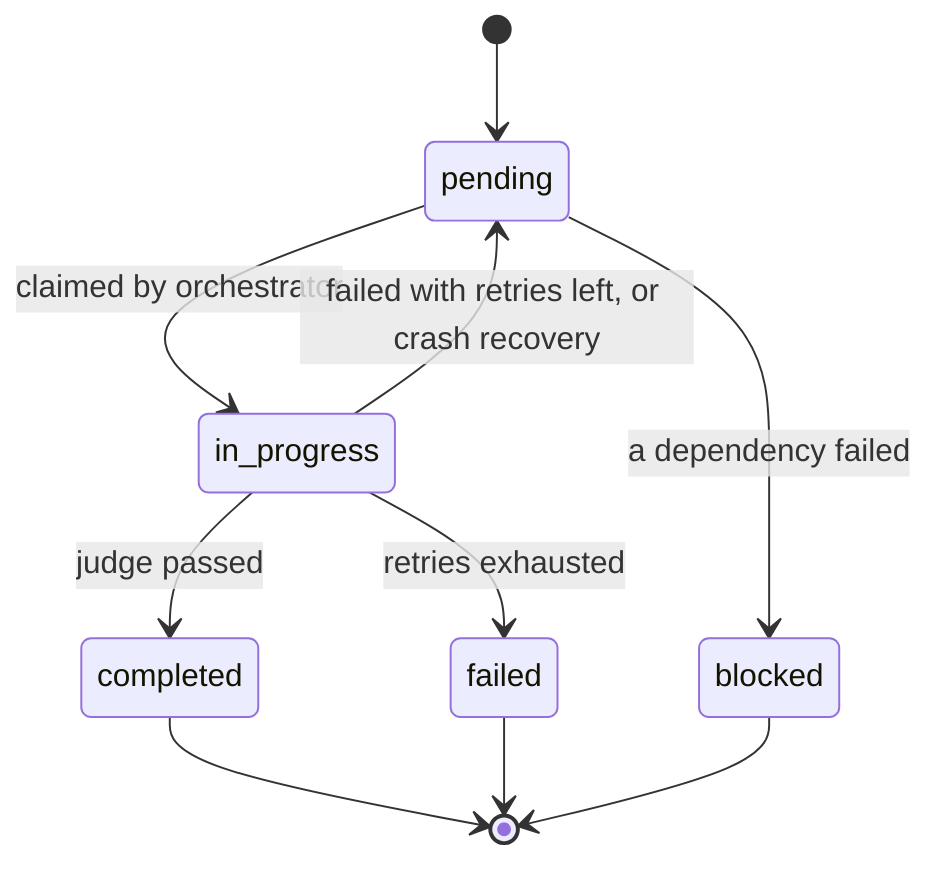
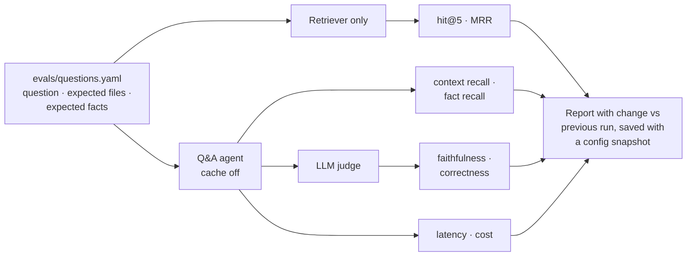

<div align="center">

# RepoPilot

**An agentic AI code assistant that answers questions about any codebase and builds new projects from a goal.**


[Features](#features) · [Architecture](#architecture) · [Getting started](#getting-started) · [Configuration](#configuration) · [Evaluation](#evaluation) · [Project structure](#project-structure)

</div>

---

Run RepoPilot inside a repository and ask questions in plain English. It searches the code before it answers, cites the files it used, and can trace exactly what calls what. Give it a goal with `/plan`: a planner breaks the goal into tasks, you approve the plan, and a team of agents builds it, with an LLM judge checking each task.

```
> /ask what happens when a plan task fails?

When a task raises, TaskOrchestrator._execute calls fail_task, which increments
retry_count and either puts the task back to pending or marks it failed once
max_retries is reached. Any task depending on it is then marked blocked by
block_unreachable_tasks, so the run ends cleanly instead of waiting forever.

Sources:
  • tasks/orchestrator.py:97-115
  • tasks/task_store.py:226-276
```

*(Illustrative output; answers vary by model.)*

## Features

| | |
|---|---|
| **Code Q&A with RAG** | tree-sitter splits code into functions and classes (Python, JS/TS, Java, Go, Rust, C/C++, C# and more). The chunks are embedded and searched before every answer. Answers render as Markdown and list their sources. |
| **Runs for free** | The default setup uses Gemini's free tier for the LLM, and local embeddings and reranking (fastembed/ONNX). It costs $0, and indexing needs no API key. Switching to OpenAI or Anthropic is one config line. |
| **Two-stage retrieval** | Vector search fetches 20 candidates. A local cross-encoder reranks them and keeps the best 5. |
| **Call-graph search** | A symbol index records every function, method, class and call site. The agent can answer *"what calls `fail_task`?"* exactly, not by similarity. |
| **Multi-agent planning** | `/plan <goal>`: a planner LLM builds a dependency graph of tasks, and you approve it or ask for changes. Each task runs with only the tools its type needs. An LLM judge checks each result against acceptance criteria. Failed tasks retry, and tasks that depend on them are blocked. |
| **Crash-safe execution** | Task state lives in SQLite (WAL mode). Tasks interrupted by a crash are recovered on the next run. |
| **Live index** | A file watcher re-indexes changed files within seconds. Unchanged files are never re-embedded. |
| **Semantic cache** | A Redis vector cache answers repeated questions instantly. It is used only for the first question of a session, so follow-ups never get a stale answer. |
| **Conversation memory** | Sessions survive restarts (LangGraph + SQLite). Long conversations are summarised automatically. |
| **Evaluation suite** | `/eval` measures retrieval (hit rate, MRR), answer faithfulness and correctness (LLM judge), latency and cost, and compares each run with the last. |
| **Cost tracking** | `/stats` shows tokens, cost and latency per feature, plus how much the cache saved. |
| **Extensible** | The agent can use skills (`SKILL.md` files loaded on demand) and MCP servers (GitHub, filesystem). |

## Architecture

### System overview



The REPL sends each command to one of three agents. `/ask` uses a tool-calling agent that searches the code. `/plan` runs a planner, then several task agents. `/eval` runs the Q&A agent on a fixed question set and scores the results. Everything that needs to persist is stored on disk in a `.repopilot/` folder inside the repo being analysed. The only exception is Redis, which runs as a separate server.

### `/ask`: answering a question



The agent chooses its tools itself. Questions about behaviour ("how does caching work?") go to `search_codebase`. Exact structural questions ("what calls `fail_task`?") go to the call-graph tools, which read the symbol index directly instead of guessing by similarity.

### Two-stage retrieval



Vector search is fast because it compares precomputed embeddings, but it ranks roughly. A cross-encoder reads the query and each chunk together, which is more accurate but too slow to run on every chunk. So vector search narrows the code down to 20 candidates, and the cross-encoder ranks those. The reranker was chosen by benchmarking three models on the eval set ([results](#retrieval-benchmark-measured)).

### Indexing pipeline



Chunks follow function and class boundaries, so a search hit is always a complete unit of code with exact line numbers. Each embedding model gets its own collection, so switching models never mixes vectors of different sizes.

### `/plan`: building a project from a goal



Each task agent gets only the tools its task type needs. For example, `review` tasks can read and write files but not run commands, and only `test` and `integrate` tasks get `run_command`. Before a task starts, the outputs of the tasks it depends on are added to its prompt.

#### Task lifecycle



The retry decision is a single SQL `UPDATE … CASE`, so a crash can never leave a task half-updated. Tasks that can no longer run are marked `blocked`, so the loop ends instead of waiting forever.

### `/eval`: measuring quality



### Where data lives

Everything RepoPilot stores goes in `.repopilot/` inside the repo being analysed:

| Path | Contents |
|---|---|
| `chromadb/` | Vector index (when using Chroma) |
| `symbols.db` | Symbol and call-graph index |
| `memory/memory.db` | Conversation sessions (LangGraph checkpointer) |
| `tasks.db` | `/plan` projects and tasks |
| `usage.db` | Tokens, cost and latency of every model call |
| `evals/` | Saved `/eval` runs |
| `logs/repopilot.log` | Detailed logs (the terminal shows only warnings) |

The semantic cache lives in Redis. With Qdrant, vectors live in your Qdrant server or cloud cluster.

## Design decisions

- **Free by default.** The LLM runs on Gemini's free tier, and embeddings and reranking run locally on CPU. Anyone can clone the project and try it without paying for an API.
- **Structural questions use structure.** "What calls X?" is a lookup, not a similarity problem, so the symbol index answers it exactly, and vector search handles conceptual questions.
- **A human approves every plan.** No code is written until you approve the plan, and you can request changes as often as you like.
- **Each task gets only the tools it needs.** A `review` task cannot run shell commands, and a `design` task cannot append to files.
- **The cache only answers when it's safe.** It is keyed on the question alone, so it is used only for the first question in a session, and it is cleared whenever the code changes.
- **Changes are measured, not assumed.** Retrieval changes are judged on the eval set. For example, the reranker was kept because hit@5 never dropped and MRR improved.

## Commands

| Command | What it does |
|---|---|
| `/ask <question>` | Answer a question about the codebase, with sources |
| `/plan <goal>` | Plan and build a project, with your approval and an LLM judge checking each task |
| `/task_status` | Show progress of the latest plan |
| `/eval [file]` | Score answer quality on a question set |
| `/stats` | Token usage, cost and cache hit rate |
| `/show_index` · `/reindex` | Inspect or rebuild the search index |
| `/new_session` · `/switch <id>` · `/session` | Manage conversations |
| `/help` · `/exit` | Show the command list, or quit |

## Getting started

**Requirements:**
- Python **3.12**. Not 3.13: `tree-sitter-languages` has no 3.13 build.
- [Poetry](https://python-poetry.org/) 2.x.
- A free Gemini API key from [Google AI Studio](https://aistudio.google.com/apikey), or an OpenAI or Anthropic key.
- Optional: Redis (for the cache), Qdrant (an alternative vector store) and Node.js (for MCP tools).

```bash
git clone https://github.com/<your-username>/repopilot.git && cd repopilot
poetry env use 3.12                # create the environment with Python 3.12
poetry install                     # installs dependencies, pytest, and the `repopilot` command

cp .env.example .env               # Windows: copy — then add your GOOGLE_API_KEY
```

Then run RepoPilot **from inside the repository you want to analyse**. `--project` tells Poetry where RepoPilot is installed, without changing which folder is analysed:

```bash
cd /path/to/any/repo
poetry --project /path/to/repopilot run repopilot
```

Or activate the environment once and run `repopilot` from any folder:
- PowerShell: `Invoke-Expression (poetry env activate)`
- bash: `eval $(poetry env activate)`

<details>
<summary>Without Poetry (plain pip)</summary>

```bash
cd repopilot
python3.12 -m venv .venv
source .venv/bin/activate          # Windows: .venv\Scripts\Activate.ps1
pip install -r requirements.txt
pip install -e . --no-deps         # registers the `repopilot` package and command
```
</details>

The first start indexes the whole repo, so it is the slow one. Later starts re-index only the files that changed.

**Optional: semantic cache.** This needs Redis 8+ or Redis Stack, for vector search. Without Redis, RepoPilot runs normally with the cache turned off.
- **Windows:** install Redis in WSL. Run `wsl --install -d Ubuntu-24.04`, then install Redis 8 from [packages.redis.io](https://redis.io/docs/latest/operate/oss_and_stack/install/install-redis/install-redis-on-linux/), and set `semantic_cache.wsl_distro`. RepoPilot starts Redis automatically.
- **Docker:** run `docker run -d -p 6379:6379 redis/redis-stack-server` and leave `wsl_distro` empty.

## Configuration

All settings live in [`src/repopilot/config.yaml`](src/repopilot/config.yaml). API keys go in `.env` in the project root; [`.env.example`](.env.example) is the template.

| Section | Controls |
|---|---|
| `llm` | Provider (`gemini` / `openai` / `anthropic`), model, a cheaper `judge_model`, and retries for rate limits. To list the Gemini models your key can use, run `python -m repopilot.llm.list_models` |
| `embeddings` | `fastembed` (local, free), `openai` or `huggingface`, and the model. Each model gets its own index, so switching is safe |
| `vector_store`, `rag`, `qdrant` | Chroma or Qdrant, and dense, sparse (BM25) or hybrid retrieval |
| `rerank` | Turn reranking on or off, and choose the cross-encoder and candidate count |
| `symbols` | Turn the call-graph tools on or off |
| `semantic_cache` | Redis URL, similarity threshold and TTL |
| `memory` | When to summarise long conversations |
| `usage.prices` | Price per 1M tokens (USD) for each model, used by `/stats` and `/eval` |

## Evaluation

[`evals/questions.yaml`](evals/questions.yaml) has 24 questions about RepoPilot's own code. Each lists the files that hold the answer and the facts a correct answer should mention. To run it, start RepoPilot in the project root and type `/eval`.

| Metric | How it's measured |
|---|---|
| Retrieval hit rate / MRR | Is an expected file in the top 5 search results, and how high is it? (deterministic) |
| Context recall | Share of expected files that the agent's tools returned (deterministic) |
| Fact recall | Share of expected facts that the answer mentions (deterministic) |
| Faithfulness | Does the retrieved code support the answer's claims? (LLM judge) |
| Correctness | Does the answer fully answer the question? (LLM judge) |
| Latency, cost | From the usage tracker |

Each run is saved with a snapshot of the configuration, and the report shows the change from the previous run. To measure what a component adds, run once with it switched off and once with it on.

### Retrieval benchmark (measured)

Search quality on the 24 questions, retrieving from RepoPilot's own code. Scores are per file, with no LLM involved:

| Embedding model | Search only: hit@5 / MRR | + reranker: hit@5 / MRR | Index time |
|---|---|---|---|
| `bge-small-en-v1.5` (default) | 83% / 0.65 | 83% / 0.68 | 38 s |
| `bge-base-en-v1.5` | 79% / 0.64 | 83% / 0.71 | 118 s |

Reranking never lowered hit@5, and it ranked the right file higher. `bge-small` is the default because it matches `bge-base`'s hit@5 with reranking and indexes 3× faster. With 24 questions, one question is about 4 points, so small gaps are within noise.

### Full `/eval` results

<!-- Fill in from your own /eval runs: run once per row, changing only the setting named. -->

| Configuration | Hit rate | MRR | Faithfulness | Correctness | Cost / question |
|---|---|---|---|---|---|
| Vector search only (`rerank.enabled: false`, `symbols.enabled: false`) | | | | | |
| + reranking | | | | | |
| + call-graph tools | | | | | |

## Project structure

```
repopilot/
├── README.md
├── pyproject.toml           dependencies and install config (Poetry)
├── poetry.lock              exact installed versions
├── requirements.txt         same dependencies, for plain pip
├── .env.example             API key template (copy to .env)
├── evals/questions.yaml     eval question set
├── tests/                   pytest suite
└── src/repopilot/           the Python package
    ├── main.py              REPL and command routing
    ├── config.yaml          all settings
    ├── agent/               /ask agent, tools, sources, query handling
    ├── context/
    │   ├── indexers/        tree-sitter chunking, Chroma/Qdrant indexing, file watcher
    │   ├── retrievers/      vector search + cross-encoder reranking
    │   └── symbol_index.py  symbol & call-graph index
    ├── tasks/               /plan: planner, approval, orchestrator, executor + judge, recovery
    ├── evaluation/          /eval metrics and runner
    ├── observability/       logging, usage & cost tracking, /stats
    ├── llm/                 model factory (Gemini / OpenAI / Anthropic), local embeddings
    ├── cache/               Redis semantic cache
    ├── memory/              sessions and summarisation
    └── skills/  mcp_integration/  tools/
```

## Tests

```bash
poetry run pytest
```

The suite covers the task store and orchestration loop, symbol extraction and call-graph queries, usage tracking, eval metrics, reranking, source formatting and code chunking. It needs no API keys.

## Tech stack

Python · LangChain · LangGraph · Google Gemini / OpenAI / Anthropic · ChromaDB · Qdrant · fastembed · tree-sitter · Redis (RedisVL) · SQLite · MCP · watchdog · Rich · pytest

---

<div align="center">
Built by <b>Parth Babariya</b>
</div>
