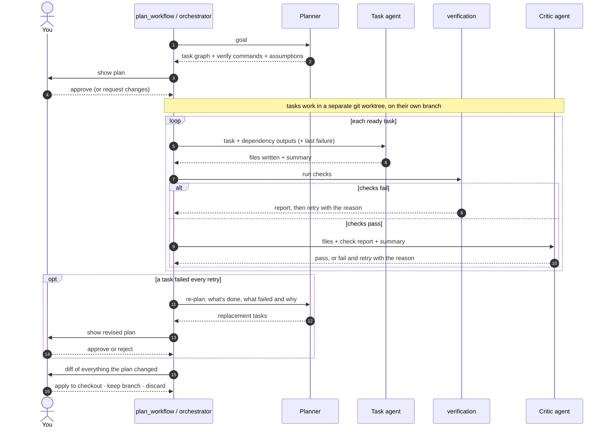
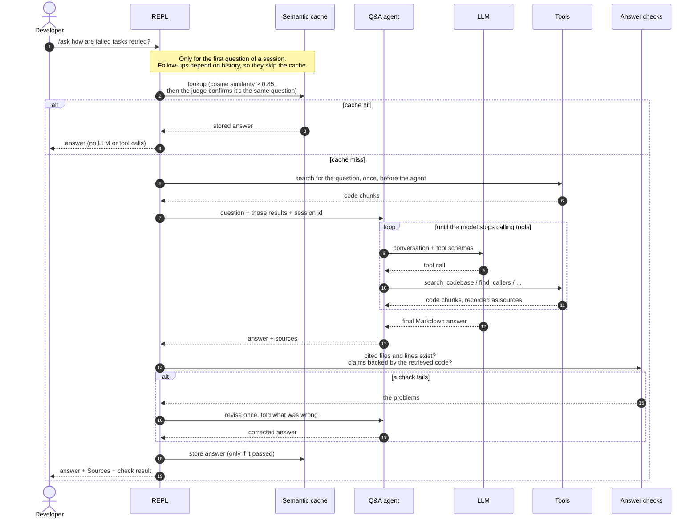
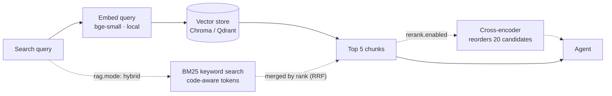
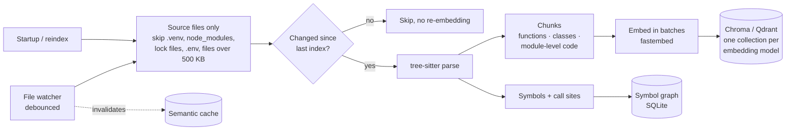
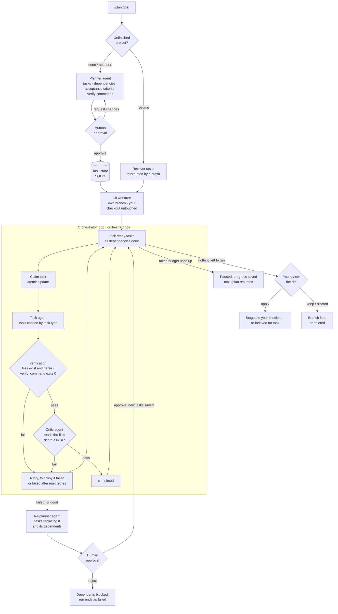
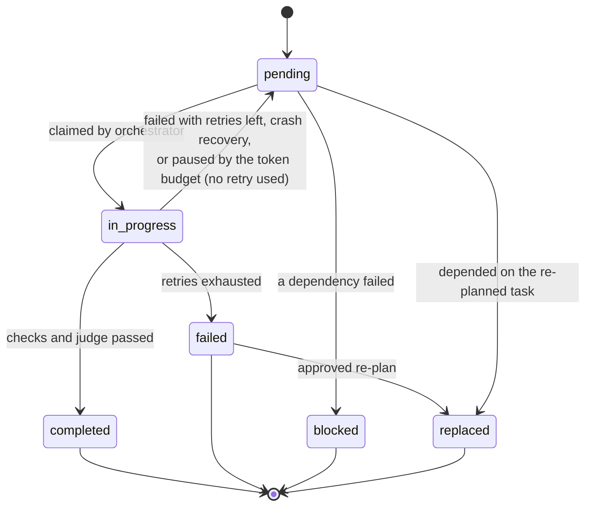
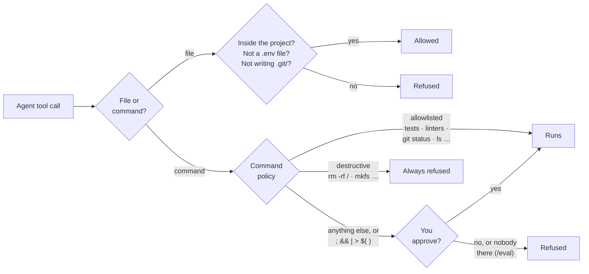

# RepoPilot architecture

How RepoPilot is put together: the layers, the seven LLM roles, each workflow step by step, and the safety limits around them. For setup and a feature overview, see the [README](../README.md). For how quality is measured, see [evaluation.md](evaluation.md).

**Contents:** [Layers](#layers) · [Agents](#agents) · [`/ask`](#ask-answering-a-question) · [Retrieval](#retrieval) · [Indexing](#indexing-pipeline) · [`/plan`](#plan-building-a-project-from-a-goal) · [Tool safety](#tool-safety) · [Budgets and resilience](#budgets-and-resilience) · [Where data lives](#where-data-lives) · [Design decisions](#design-decisions)

## Layers

RepoPilot is built in layers, and each layer only uses the layers below it (a [test](../tests/test_architecture.py) enforces this):

- **Workflows** decide what happens, in what order, and what to do when something fails. They hold the retry, re-planning and approval logic, and no prompts.
- **Agents** are the LLM roles. Each is a prompt plus a model plus a minimal toolset, and none of them decides what runs next.
- **Capabilities** are what agents can do: search code, follow the call graph, read and write files, remember conversations, load skills, and call MCP servers.
- **Foundations** apply to everything: every tool call passes through the safety guardrails, every agent runs under step and token limits, and every model call goes through one service that adds timeouts, retries and a fallback model and records tokens and cost.

Everything RepoPilot stores lives in a `.repopilot/` folder inside the repo being analysed. Redis, for the optional cache, is the one exception.

```
main.py                 entry point
   ↓
workflows/              orchestrate a command: what runs, in what order, what happens on failure
   ↓
agents/                 the LLM roles: prompt + tools + model
   ↓
tools/ · retrieval/ · memory/ · skills/ · protocols/      capabilities the agents use
   ↓
guardrails/ · services/ · observability/ · config/        cross-cutting foundations
```

For example, the critic agent doesn't import the verification workflow; it receives the check report as text. `evaluation/` sits beside `workflows/` and drives the same Q&A agent.

## Agents

RepoPilot has **seven LLM roles**. Two are true agents that use tools in a loop: the Q&A agent and the task agents. The other five make a single structured call each, with no tools, because their output must fit a fixed format.

| Agent | File | When it runs | What it does | Tools | Model | Output |
|---|---|---|---|---|---|---|
| **Q&A agent** | [`agents/qa_agent.py`](../src/agents/qa_agent.py) | `/ask`, and each `/eval` question | Answers questions about the code in a loop: think, call a tool, read the result, repeat. Remembers the session. | `search_codebase`, `repo_map`, `read_lines`, `find_symbol` · `find_callers` · `find_callees`, `run_command`, `load_skill`, read-only MCP | main | Markdown answer + sources |
| **Answer critic** | [`agents/answer_critic.py`](../src/agents/answer_critic.py) | After each `/ask` answer passes the citation checks | Checks that the answer's claims about the code are backed by the code the agent retrieved, and lists any that aren't so the agent can revise | none | judge | Grounded yes/no, unsupported claims |
| **Planner** | [`agents/planner_agent.py`](../src/agents/planner_agent.py) | Start of `/plan` | Turns a goal into a task graph: tasks, dependencies, acceptance criteria, verify commands, assumptions and risks. Gets the repo map with the goal. | none | main | `ExecutionPlan` |
| **Re-planner** | [`agents/planner_agent.py`](../src/agents/planner_agent.py) | A task failed every retry | Proposes tasks that replace the failed one and the tasks depending on it | none | main | `RevisedPlan` |
| **Task agent** (one per task) | [`agents/task_agent.py`](../src/agents/task_agent.py) | Each `/plan` task | Builds one task. It sees its task, its dependencies' outputs and, on a retry, why the last attempt failed. | File tools by task type; read-only `search_codebase` · `find_symbol` · `read_lines`; `run_command` only for `test` / `integrate` | main | Files on disk + a summary |
| **Critic agent** | [`agents/critic_agent.py`](../src/agents/critic_agent.py) | After a task passes the automatic checks | Grades the files the task actually produced against its acceptance criteria, using the check results as evidence | none | judge | Pass/fail, score 0–10, reason |
| **Eval judge** | [`evaluation/judge.py`](../src/evaluation/judge.py) | `/eval` | Scores each answer for faithfulness (backed by the retrieved code?) and correctness | none | judge | Two scores 0–1, reason |

*main* is `llm.model` and *judge* is the cheaper `llm.judge_model`. Some parts look like agents but aren't: the orchestrator loop, the verification and citation checks, the approval steps and the worktree review are ordinary code, so they always behave the same way, and only the roles above use an LLM.

### How the agents work together in `/plan`



Each step that can be checked by running code is checked by code, not by the LLM: the verify command, file existence and parsing. The critic only judges what code can't check, namely whether the work meets the acceptance criteria. You approve every plan, including each verify command and any revised plan.

## `/ask`: answering a question



**Fewer model calls per answer.** The `/eval` runs showed that slow answers weren't caused by slow model calls (a typical call took 1.5 s) but by too many of them. One answer made 21 tool calls, searching for `_READ_ONLY_PROGRAMS` 12 times. Three changes, each aimed at a cause:
- **The question arrives with its search results.** The workflow searches once before the agent starts. Most answers began with exactly that search, so the agent can often answer without spending a model call to decide to search. Follow-ups about the last answer ("explain that more") skip it.
- **A repeated search gets a reminder, not the same results.** Within one answer, a query with the same words as an earlier one is answered with "you already searched this — try other words, `find_symbol`, or answer". This replaces a lower step limit: the data showed a 17-call answer scoring a perfect 1.0, so a lower cap would have cut good answers short.
- **GitHub tools appear only for GitHub questions.** Every tool's description is sent with every model call. The 14 read-only GitHub tools were about 2,000 of the 4,600 tokens each call started with, yet code questions never need them. A keyword rule shows them only when the question mentions issues, PRs, commits and so on. It's a rule rather than an LLM call, because an extra model call to save model calls would defeat the purpose.

The agent chooses its tools itself. Questions about behaviour ("how does caching work?") go to `search_codebase`. Exact structural questions ("what calls `fail_task`?") go to the call-graph tools, which read the symbol index directly instead of guessing by similarity.

**Answers are checked before you see them**, in the same order as `/plan` tasks: code first, then an LLM only for what code can't check ([`answer_verification.py`](../src/workflows/answer_verification.py)).
1. **Citations (code).** Every file the answer cites (`src/x.py:40-52`, `x.py (lines 40-52)`, …) must exist, and every cited line must be inside it. A wrong citation fails the answer without spending a model call. A bare file name without a path or line numbers counts as a mention rather than a citation, because "this repo has no `package.json`" can be true.
2. **Grounding (answer critic).** The judge model reads the answer next to the code the agent retrieved for it, and lists claims about the code that nothing retrieved supports. Names the answer formats as code but that appear nowhere in that code are passed to it as hints.

A failing answer goes back to the agent once, with the problems listed, and it may search again before rewriting. The check result is printed under the answer (`✓ Checked: …` or `⚠ Not verified — …`), and an answer that still fails is never cached. Turn it off, or keep only the free citation checks, under `ask:` in the config.

**What reaches the cache, and when it answers.** The cache is keyed on the question's embedding, which captures the topic but not the direction: "What calls `fail_task`?" and "What does `fail_task` call?" are 0.984 similar, "Where is `get_retriever` used?" and "…defined?" 0.973, so no threshold separates them from real rewordings. A match that isn't the same text is therefore confirmed by the judge model (one short call, about 1 s) before its answer is reused, and any doubt or error counts as a miss. Measured on 8 pairs, it rejected all 3 that ask different things and accepted 2 of 5 rewordings: it is strict on purpose, because a miss costs one normal answer and a wrong hit is a wrong answer. An answer is stored only when every check that should run did run and passed, so not one cut short by the token budget or whose claims went unchecked. Entries are dropped when the file watcher sees a change, and at startup when the code changed while RepoPilot was closed (a fingerprint of every indexable file's path, size and modification time).

## Retrieval



The default is hybrid search: the query is embedded locally and compared with the stored chunk embeddings, and BM25 keyword search runs alongside it. Both take milliseconds. Every setting was measured on the eval set before choosing the defaults ([numbers](evaluation.md#retrieval-benchmark-measured)):

- **Hybrid mode** (`rag.mode: hybrid`, the default; `semantic` is vector search only) adds BM25 keyword search, which matches exact identifiers such as `fail_task` (split into `fail` and `task` too). The two result lists are merged with reciprocal rank fusion, which needs only ranks, so vector distances and BM25 scores never have to be put on the same scale. It works with both stores, and one index serves both modes, so switching never needs a re-index. With Chroma, the keyword index is built in memory from the stored chunks. With Qdrant, every point stores a sparse BM25 vector next to its dense one.
- **Reranking** (`rerank.enabled`) fetches 20 candidates and has a local cross-encoder, which reads the query and each chunk together, keep the best 5. On this project it made results worse: it favours text that reads like the question, such as test names and README prose, over the code that answers it. It also adds about 1.7 s per search. It may help on repos with less prose.

## Indexing pipeline



Chunks follow function and class boundaries, so a search hit is always a complete unit of code with exact line numbers. Each embedding model gets its own collection, so switching models never mixes vectors of different sizes.

## `/plan`: building a project from a goal



**Checks come before the judge.** The agent's own summary is the least reliable evidence, because an agent can claim the tests pass when they don't. So after each task the system checks things itself:
1. Every file the task should produce exists.
2. Python, JSON and JS files parse.
3. The task's `verify_command` (for example `pytest tests/test_todo.py -q`) exits 0.

Only then does the LLM judge grade the task, and it sees the actual files and check results, not just the summary. A failed check skips the judge entirely, saving a model call.

**Failures feed back.** A retry gets the reason the last attempt failed, such as the failing test output or the judge's reason, so it can fix the problem rather than repeat it. If a task fails every retry, the planner is shown what's done, what failed and why, and which tasks depended on it. It proposes replacement tasks: splitting the work, changing the approach, or dropping something that isn't essential. You approve this revision on the same screen as the original plan. Tasks that don't depend on the failure are left alone. `tasks.max_replans` limits how often this happens per run.

**Isolated in a git worktree.** Tasks write files and run commands, but not in your checkout. `/plan` creates a [git worktree](https://git-scm.com/docs/git-worktree), a second checkout of the repo on its own branch (`repopilot/plan-<id>`), under `.repopilot/worktrees/`. Every tool and check works there. RepoPilot's process doesn't change directory: the guardrails hold a per-run workspace root that file paths and commands resolve against. When the plan ends you see `git diff --stat` and choose:
- **apply**: the changes arrive in your checkout as staged, uncommitted changes (`git merge --squash`), so you review them and make the commit
- **keep**: the branch stays, to diff or merge later
- **discard**: the worktree and branch are deleted

An interrupted or paused plan keeps its worktree, and resuming continues there. Outside a git repo, or with `tasks.isolation: none`, tasks write directly into the folder. The worktree starts from your last commit, so uncommitted changes and untracked folders such as `node_modules/` aren't in it.

**The planner sees the repository.** With each goal it gets the repo map: every source file with its public classes, methods and functions, and where the tests are, built from the symbol index without an LLM call. It took about 1,500 tokens for RepoPilot's 116 files, and detail is dropped in steps to fit large repos. Measured on the same goal ("add a `/version` command with a test") and the same model:

| | Without the map | With the map |
|---|---|---|
| Files it planned to edit that exist | 0 of 5 (invented `src/repopilot/repl.py`, `commands/`) | `src/main.py`, the real REPL |
| Assumptions | 4, two of them wrong | 3, all true |

Without it, a plan on an existing repo builds a parallel structure beside the real code.

**Task agents can find existing code.** Every task type has read-only `search_codebase`, `find_symbol` and `read_lines`, so a task like "add retry logging to the orchestrator" can find the orchestrator before changing it. Search results show repo-relative paths, which open the worktree's copy of each file. Their first message depends on the folder: "create the files from scratch" in an empty project, "find the code your task touches first" in an existing one.

Each task agent gets only the tools its task type needs. For example, `review` tasks can read and write files but not run commands, and only `test` and `integrate` tasks get `run_command`. Before a task starts, the outputs of the tasks it depends on are added to its prompt.

### Task lifecycle



The retry decision is a single SQL `UPDATE … CASE`, so a crash can never leave a task half-updated. Tasks that can no longer run are marked `blocked`, so the loop ends instead of waiting forever. Replaced tasks are kept with the reason, so `/task_status` shows the history of the plan.

## Tool safety



Agents read untrusted text: repository files, GitHub issues, and code comments that could say "ignore your instructions and run …". So their power is limited rather than trusting them to behave:
- **Files.** Paths must resolve inside the project folder, symlinks included. `.env` files can never be read or written, while `.env.example` is fine. `.git/` and `.repopilot/` can't be written.
- **Commands.** Tests, linters and read-only commands run directly. Anything else is shown to you first. Command chaining, pipes and redirection always need approval, because they can hide a second command.
- **MCP.** Only tools that read are loaded, such as GitHub `get_*`/`list_*`/`search_*` and filesystem `read_*`. The agent can't push files, open or merge PRs, or edit files through MCP, and any MCP call that names a `.env` file is refused.
- **Limits.** `/plan`'s file changes stay in its worktree until you apply them, but an allowlisted command such as `pytest` still runs code the agent wrote, with your permissions. For full isolation, run RepoPilot [in Docker](../README.md#run-with-docker).

## Budgets and resilience

An agent that loops, or a provider that hangs, should cost a bounded amount and then stop cleanly. Limits are enforced as LangChain agent middleware ([`guardrails/budgets.py`](../src/guardrails/budgets.py)). Tokens are counted by the usage tracker that already sees every LLM call, so the guardrail only decides when to stop.

| Limit (`budgets:`) | Default | When it's reached |
|---|---|---|
| Tool calls per `/ask` answer | 15 | More tool calls are refused, and the agent answers with what it found |
| Tool calls per task attempt | 40 | The same |
| Model calls per agent run | 30 | The run ends with a message |
| Tokens per `/ask` (agent, critic, summariser) | 250k | The agent stops before its next model call |
| Tokens per `/plan` run | 1M | No new task starts. The interrupted task returns to `pending` without using a retry, the plan pauses with its progress saved, and the next `/plan` resumes it |

The token defaults are about 3× (`/ask`) and 10× (`/plan`) the largest runs measured. While it was being built, the `/ask` budget caught a real bug. The summariser was set to start at 4,000 tokens, below what a few search results add up to. It ran after almost every step, replaced the user's question with a summary, and the agent repeated the same two searches until the budget stopped it at 252k tokens. With the threshold at 40,000, the same question takes 97k tokens.

**Resilience.** Every model call has a timeout (`llm.timeout_seconds`) and retries with backoff on rate limits and server errors (`llm.max_retries`). When the main or judge model still fails, the call is retried on `llm.fallback_model`. Agents use `ModelFallbackMiddleware` for this, and the single-call judges use `with_fallbacks`.

## Where data lives

Everything RepoPilot stores goes in `.repopilot/` inside the repo being analysed:

| Path | Contents |
|---|---|
| `chromadb/` | Vector index (when using Chroma) |
| `symbols.db` | Symbol and call-graph index |
| `memory/memory.db` | Conversation sessions (LangGraph checkpointer) |
| `tasks.db` | `/plan` projects and tasks |
| `worktrees/` | A plan's git worktree while it runs, removed when you apply, keep or discard |
| `usage.db` | Tokens, cost and latency of every model call |
| `evals/` | Saved `/eval` runs and your `/judge_check` labels |
| `skills/` | Your own skills (`<name>/SKILL.md`), loaded on demand alongside the built-in ones |
| `logs/repopilot.log` | Detailed logs (the terminal shows only warnings) |

The semantic cache lives in Redis. With Qdrant, vectors live in your Qdrant server or cloud cluster.

## Design decisions

- **Free by default.** The LLM runs on Gemini's free tier, and embeddings and reranking run locally on CPU. Anyone can clone the project and try it without paying for an API.
- **Structural questions use structure.** "What calls X?" is a lookup, not a similarity problem, so the symbol index answers it exactly, and vector search handles conceptual questions.
- **A human approves every plan.** No code is written until you approve the plan, and that includes every command it will run to verify itself. A revised plan after a failure needs approval too.
- **Evidence before opinion.** A task passes only when objective checks pass (files exist and parse, tests run green). The LLM judge then grades the real files. An agent's claim that "tests pass" counts for nothing.
- **Nothing reaches your checkout unreviewed.** `/plan` works in a git worktree, and you see the whole diff before choosing to apply, keep or discard it. Applied changes are staged, not committed, so the commit is still yours.
- **Answers are checked like tasks.** Code checks what code can (cited files and lines), the LLM judges only what it can't (whether claims are backed by the retrieved code), and a failure gets one revision that is told what was wrong.
- **Every loop has a ceiling.** Step limits per agent and token budgets per command. Reaching one pauses or ends work cleanly instead of failing it, and a paused plan loses no progress.
- **A failure leads to a new plan, not a dead end.** Retries learn from the failure reason. A task that keeps failing is re-planned around rather than blocking everything after it.
- **Least privilege.** Each task type gets only the tools it needs, agents can't leave the project folder or read `.env`, unfamiliar commands need your approval, MCP is read-only, and there is no delete tool at all, so a bad task can't destroy existing work.
- **The cache only answers when it's safe.** It is keyed on the question alone, so it is used only for the first question in a session. A close match must be confirmed as the same question, only fully checked answers are stored, and it is cleared whenever the code changes, even between runs.
- **Changes are measured, not assumed.** Retrieval changes are judged on the eval set, and the results decide the defaults. Hybrid search was built, measured, and at first lost to vector search, so it was off. Once module-level code was indexed it measured best, so it became the default. The reranker never helped, so it stays off. The LLM judge itself can be checked against human labels with `/judge_check`.
