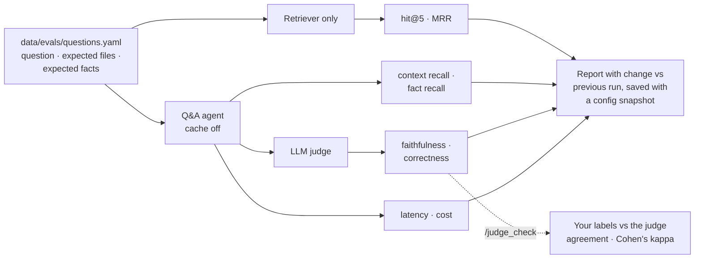

# Evaluating RepoPilot

How answer quality is measured, whether the LLM judge can be trusted, and the measured results. Architecture is in [architecture.md](architecture.md); setup is in the [README](../README.md).

**Contents:** [Metrics](#metrics) · [`/judge_check`](#can-the-judge-be-trusted-judge_check) · [Retrieval benchmark](#retrieval-benchmark-measured) · [Full `/eval` results](#full-eval-results)

## Metrics

[`data/evals/questions.yaml`](../data/evals/questions.yaml) has 24 questions about RepoPilot's own code. Each lists the files that hold the answer and the facts a correct answer should mention. To run it, start RepoPilot in the project root and type `/eval`.

| Metric | How it's measured |
|---|---|
| Retrieval hit rate / MRR | Is an expected file in the top 5 search results, and how high is it? (deterministic) |
| Context recall | Share of expected files that the agent's tools returned (deterministic) |
| Fact recall | Share of expected facts that the answer mentions (deterministic) |
| Faithfulness | Does the retrieved code support the answer's claims? (LLM judge) |
| Correctness | Does the answer fully answer the question? (LLM judge) |
| Latency, cost | From the usage tracker |

**Why both kinds of metric?** The deterministic metrics ([`metrics.py`](../src/evaluation/metrics.py)) are free, exactly repeatable and unit-tested, but they only check *what* was retrieved and *which* words appear. An answer can mention every expected fact and still be wrong, or invent a function that doesn't exist. The LLM judge ([`judge.py`](../src/evaluation/judge.py)) catches those cases. It is a separate `judge_model` running at temperature 0. It sees the code the agent retrieved (the chunks most relevant to the answer, up to 12,000 characters), so it can check each claim against the evidence. Its cost is reported separately so it doesn't inflate the cost per question.

Each run is saved with a snapshot of the configuration, and the report shows the change from the previous run. To measure what a component adds, run once with it switched off and once with it on.

## Can the judge be trusted? `/judge_check`

An LLM judge is itself a model that can be wrong, so its scores mean something only if they match a person's. After an `/eval` run, `/judge_check` shows each answer with the judge's scores hidden, so they can't bias you, and asks two questions: *is it correct and complete?* and *does it state anything false about the code?* Your labels are saved, so you can stop and continue later. It then reports, for each metric, how often the judge agrees with you and **Cohen's kappa**, which is agreement corrected for chance (above 0.6 is substantial). It also lists every answer where you and the judge disagree. About 15–20 labelled answers are enough for a first estimate.

<!-- Fill in from your own /judge_check: -->
| Metric | Labelled | Agreement with human | Cohen's kappa |
|---|---|---|---|
| Faithfulness | | | |
| Correctness | | | |

## Retrieval benchmark (measured)

Search quality on the 24 questions, retrieving from RepoPilot's own code with `bge-small-en-v1.5`. Scores are per file, with no LLM involved. Reproduce them with `python scripts/benchmark_retrieval.py`; it's free and needs no API key.

| Search | hit@5 before → now | MRR before → now | Time / query (laptop CPU) |
|---|---|---|---|
| Vector only | 88% → 92% | 0.64 → 0.68 | 0.03 s |
| Vector + reranker | 75% → 88% | 0.61 → 0.69 | 1.8 s |
| **Hybrid (vector + BM25), the default** | 79% → **92%** | 0.62 → **0.75** | 0.05 s |
| Hybrid + reranker | 79% → 92% | 0.60 → 0.67 | 1.6 s |

**What changed between the two columns:** module-level code is now indexed. The index used to hold only functions and classes, so constants and config tables such as `_ALWAYS_DENIED`, `_READ_ONLY_PROGRAMS` and `TOOLS_BY_TYPE`, and the header comments explaining them, could never be found. This was also the cause of the 12 repeated searches in `/eval`. Every mode improved, and hybrid improved most, because keyword search is built for exact names. It went from worst to best, so it is now the default. Existing indexes upgrade themselves: chunks record the chunker version, and files indexed by an older version are re-chunked on the next start.

- **Hybrid** is the default now. Before module-level code was indexed, its keyword matches went mostly to test files that repeat a function's name, and it lost to vector search.
- **Reranker** stays off. It adds nothing on top of hybrid search (MRR 0.75 → 0.67) and costs about 1.7 s per search. The cross-encoder scores how much a chunk *reads like* the question, and test names and README paragraphs read that way.

With 24 questions, one question is about 4 points, so small gaps are noise. The numbers also move as the code changes, which is why the script is in the repo. `bge-small` is the default embedding model because, in an earlier comparison, it matched `bge-base`'s accuracy and indexed about 3× faster.

## Full `/eval` results

All 24 questions, agent `gemini-3.5-flash-lite`, judge `openai/gpt-oss-20b` on Groq, `bge-small` embeddings, Chroma, call-graph tools on. All of it ran on free tiers.

| Metric | 2026-10-17 | 2026-10-18 (current) |
|---|---|---|
| Search | vector | hybrid (vector + BM25) |
| Answered without error | 24 / 24 | 24 / 24 |
| Retrieval hit rate (top 5) | 88% | 92% |
| Retrieval MRR | 0.63 | 0.72 |
| Context recall (expected files the agent's tools returned) | 94% | 96% |
| Fact recall (expected facts the answer mentions) | 89% | 92% |
| Faithfulness (LLM judge, 0–1) | 0.91 | 0.98 |
| Correctness (LLM judge, 0–1) | 0.92 | 0.96 |
| Answers scoring ≥ 0.9 on both judge metrics | 19 / 24 | 22 / 24 |
| Answer time: median / mean / slowest | 7.7 s / 17.2 s / 87 s | 3.1 s / 4.5 s / 17 s |
| Cost per question | $0 (free tiers) | $0 (free tiers) |

**What changed between the runs.** Answers are about 4× faster on average because RepoPilot now searches once before the agent starts (most questions are answered from that search, with no further tool calls), module-level code such as constants and config tables is indexed, and a repeated search returns a reminder instead of the same results. Hybrid search became the default after the retrieval benchmark above.

**Read the judge scores with one caveat.** Part of the faithfulness and correctness gain comes from fixing the judge, not the agent. The judge used to read only the first 12,000 characters of what the agent retrieved; when an answer came from a read after several searches, the evidence was cut and the judge marked correct answers as unsupported. On 2026-10-18 it did that to two answers that were checked by hand against the code and are correct. It now gets the chunks that back the answer (the same selection the `/ask` answer critic uses). The same day's run with the old judge scored 0.92 faithfulness and 0.89 correctness. Retrieval, recall and timing don't depend on the judge, so those columns compare directly.

The remaining low scores are partial answers: `retriever_choice` doesn't mention hybrid mode and `llm_provider` doesn't name `get_llm` (0.6 correctness each).

The eval runs also exposed problems that are now fixed:
- **The summariser removed the question mid-answer.** An answer that took 10 searches pushed its own question out of the kept window, the question was summarised away, and the agent replied as if the conversation had been reset. Summarisation now never touches the question being answered.
- **MCP errors ended answers.** Two GitHub MCP lookups that returned "Not Found" each aborted the whole answer. MCP errors now come back to the agent as tool results.
- **A quota error is reported, not hidden.** In one run the main model was overloaded and the fallback model had used its 20 requests for the day, so one question failed. The report counts it as an error rather than a score.

<!-- Fill in from your own /eval runs: run once per row, changing only the setting named, with the same judge model. -->

| Configuration | Hit rate | MRR | Faithfulness | Correctness | Cost / question |
|---|---|---|---|---|---|
| Call-graph tools off (`symbols.enabled: false`) | | | | | |
| Default: hybrid search + call-graph tools | 92% | 0.72 | 0.98 | 0.96 | $0 |
| + reranking (`rerank.enabled: true`) | | | | | |

Comparing settings takes one `/eval` per row, about 190 model calls each. On free tiers that is more than a day's quota allows: Gemini Flash-Lite gives 500 requests per day per model, and Groq gives 200k tokens per day per model, about two runs of judging.
